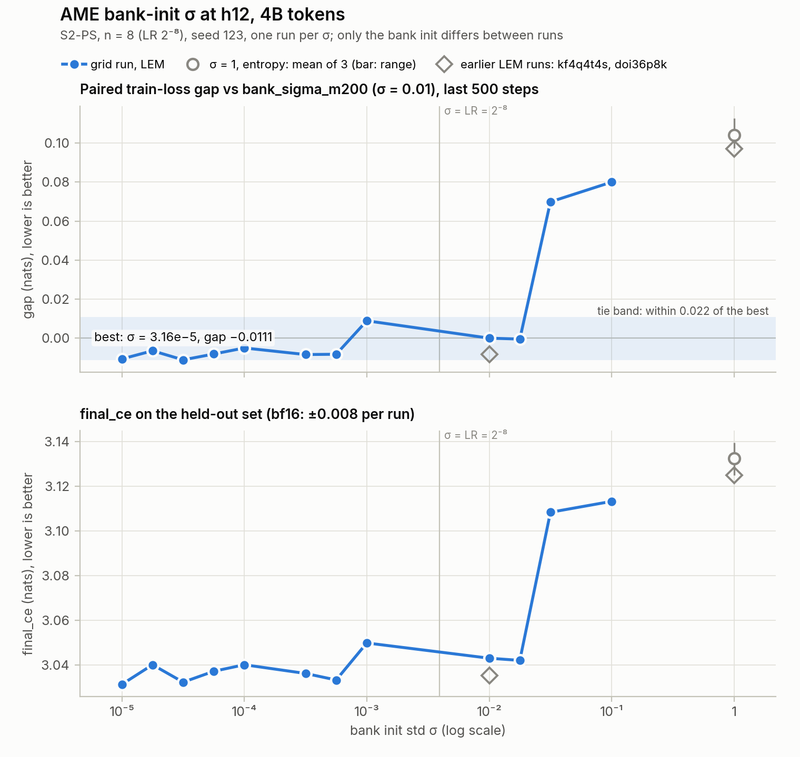

# AME bank-init σ grid at h12 (plan and log)

**Status:** EXTENDED, 2026-11-17: 12 runs in 3 rounds on LEM, then round 4 (σ =
1e-10 and 1e-7) to find the lower failure edge, which the 12 runs never reached.

**Question:** which bank init std σ is best for S2-PS at h12, 4B tokens? Bank-gates
stage 2 showed σ = 0.01 beats σ = 1 (−0.0895 in final_ce,
[ame_bank_gates_stage2_report.md](ame_bank_gates_stage2_report.md)); nothing else
was tried.

Maciej, 2026-11-12: "do a sequential grid to find optimal σ for h12 4B tokens
training, submit at most 4 x 1 gpu jobs at once for entropy, so no more than 2 gpus
are occupied by my jobs, use optimal lr for this grid search, stop after 12
experiments and draw a chart of results".
Maciej, 2026-11-13, with round 1 still queued on entropy: "move them to lem, they
will start there faster, dont run anything on entropy".
Maciej, 2026-11-17, on the 12-run answer: "you have failed the grid seach of optimal
sigma - you didnt go as far as you should into smaller number, and you havent found
the smaller sigma that fail as a initialization, try 10^-10 now than -7 - run those
two experiemnts and replot the chart with them".

## The answer

(The numbers behind the chart:
[ame_bank_sigma_figures/sigma_grid.json](ame_bank_sigma_figures/sigma_grid.json);
redraw it with `scripts/bank_sigma_chart.py`.)

- **The optimum is a plateau, not a point.** All ten σ from 1e-5 to 0.0178 tie.
  - Their last-500 gaps against σ = 0.01 run from −0.0111 to +0.0089. That spread,
    0.020, is inside one tie band (0.022).
  - The same config rerun differs by 0.008 (`kf4q4t4s` against `bank_sigma_m200`).
  - So one run per σ can't rank σ inside the plateau.
  - The measured best is **σ = 3.16e-5** (−0.0111; final_ce 3.032 against 3.043).
- **A cliff between 0.0178 and 0.0316:** from −0.0005 to +0.070 within a
  quarter-decade. 0.1 is +0.080, and σ = 1 is +0.097 (`doi36p8k`).
  - Above the cliff, early learning is slower: +0.30 in steps 0-99 at 0.0316.
  - Both runs above it had a large loss-spike episode, and neither caught up by 4B
    tokens.
  - At 0.0178 the init still costs early (+0.12 in steps 0-99), but the gap is
    gone by the second quarter.
- **A soft floor near 2e-5.** At step 2855, the same batch in every run, the
  banks' gradient norm grows steeply as σ falls:
  - 0.005-0.007 at σ ≥ 0.0178;
  - 0.28 at 1e-4;
  - 1.49 at 1.78e-5 and 2.19 at 1e-5.

  At σ ≤ 1.78e-5 that one batch tripped the global clip (1.0), which shrank the
  whole step for every weight, by 0.67 and 0.46. It happened once and cost no loss.
  Most likely a rare token's row was still near its tiny draw: under the hard
  QK-norm its gradient scales as 1/‖row‖.
- **Recommendation: σ = 1e-4** (or anything from about 3e-5 to 1e-3), mid-plateau.
  - It sits two decades below the cliff and well above the floor.
  - It ties the measured best: −0.0050, within noise of −0.0111.
  - σ = 0.01, the current recipe, ties too, but it is only a quarter-decade below
    the cliff.
  - If the cliff tracks the LR, as the mechanism suggests, a lower LR would bring it
    closer to 0.01. Here the cliff sits at 4.6-8.1× the LR (2⁻⁸). This is untested;
    the grid ran only n = 8.

## The runs

- **Recipe: `kf4q4t4s`'s** ([configs/bank_gates/stage2_none_std001.yaml](../../configs/bank_gates/stage2_none_std001.yaml)):
  S2-PS (AME with the KV shift and ALiBi), h12, 3,815 steps = 4B tokens, no gate,
  bank LR ratio 1, seed 123.
  - **n = 8 (LR 2⁻⁸),** S2-PS's optimum and the LR of both earlier σ points.
  - **Only σ changes.** With one seed, every run sees the same batches, and every
    weight but the banks starts the same. The banks start as σ × the same standard
    normals. So any two runs are an exact pair.
- **On LEM, as `kf4q4t4s` ran** (one H100 per run, node r16-11 excluded). Two
  differences from `kf4q4t4s`, neither in the training:
  - no final checkpoint, so no `token_counts.pt` (`count_token_updates` off): the
    grid needs only the curves and final_ce (*Decisions* 2);
  - names: σ = 10^(−m/100), run `bank_sigma_m<m>` (m200 is σ = 0.01), so names
    carry no ".".
- **Concurrency, Maciej's limit:** each round is one sbatch array of 4 runs with at
  most 2 running (`--array=0-3%2`). One round takes about 9 h (`kf4q4t4s`: 4.3 h).
  Nothing runs on entropy.
- **Configs:** `configs/bank_sigma/round<k>.yaml` on branch `bank_sigma_grid`
  (worktree `~/code/nano-bank-sigma`). Tools on the branch:
  [scripts/grid_points.py](../../scripts/grid_points.py) (compose and check a grid as
  `run_exp.py` does), [scripts/paired_gap.py](../../scripts/paired_gap.py),
  [scripts/watch_array.py](../../scripts/watch_array.py),
  [scripts/bank_sigma_next.py](../../scripts/bank_sigma_next.py) (the next round's
  picks), [scripts/bank_sigma_chart.py](../../scripts/bank_sigma_chart.py) (the chart
  and the Results table).

## The measure

- **g(σ):** the last-500 paired train-loss gap against `bank_sigma_m200`, the σ =
  0.01 run on LEM. Lower is better.
- **A difference inside ±0.022 is a tie** (AME's same-seed floor).
- **Also logged:** final_ce (bf16, ±0.008), spikes, the grad-norm max, s/step, and
  the banks' share of the clipped gradient norm.
- **Points for free, shown on the chart but not used to pick:**
  - `kf4q4t4s` (σ = 0.01) and `doi36p8k` (σ = 1), both on LEM;
  - σ = 1 on entropy: the parity study's three same-seed runs of `doi36p8k`'s
    config (W&B `nano-ame-parity`: `u1zpx7lt`, `s65ebe41`, `w4hmw00o`), their mean,
    one cluster away.

## The rounds

x = log10 σ; x* is the best measured point so far (lowest g). A point already
measured is skipped, and the next rule fills the slot.

- **Round 1, decades:** x = −2 (σ = 0.01 again: the anchor of every pair, and a
  same-cluster replicate of `kf4q4t4s`), −4, −3, −1. The array runs −2 and −4
  first.
- **Round 2, half-decades.** In order, until there are 4:
  1. if x* is the lowest x measured, x* − 1: the curve may still be falling;
  2. x* − 0.5 and x* + 0.5;
  3. the midpoint of the interval between measured neighbours with the largest
     |Δg|, the knee; repeat.
- **Round 3, quarter-decades.** In order, until there are 4:
  1. if x* is the lowest x measured, x* − 0.5;
  2. x* − 0.25 and x* + 0.25;
  3. on each side, the quarter-decade point that bisects the gap between the
     outermost point of the tie band (g ≤ g(x*) + 0.022) and the first point
     outside it;
  4. rule 3 of round 2.
- **When the rules run short** (added 11-13, before any result): one step, then two,
  beyond the end of the measured range with the lower g, the end nearer the optimum.
  Round 2 can run short: 4 decades have only 3 interior half-decades, and x* ± 0.5
  are two of them.
- **[scripts/bank_sigma_next.py](../../scripts/bank_sigma_next.py) applies these
  rules** to the measured g and prints the picks in task order, with the rule behind
  each.
- **The answer:** the best σ and the tie band, as σ ranges. The chart plots g and
  final_ce against σ on a log axis.

## What to expect

- **The mechanism** (stage 2's reading): under the hard QK-norm a bank row's
  direction is all the scores see. Adam moves each element by about lr per step, so
  a row turns at about lr/σ. A small σ turns fast, and that helped rare tokens most
  (stage 2: CE on tokens seen 101-1,000 times 2.962, against 3.305).
- **A plateau is likely below σ ≈ lr = 0.004,** where the first updates overwrite
  the draw.
- **A risk for tiny σ:** a bank row's gradient scales as 1/σ through the norm, and
  the clip (1.0) acts on the joint norm, banks included. If the banks dominate it,
  every other weight's step is cut as well. The logged bank share of the norm and
  clip factor show it.

## Log

### Implementation

2026-11-12, branch `bank_sigma_grid` from `ame_main` at `2299c1ee`. No code change:
the training code and the configs it reads are unchanged since `03317133`, the
commit `kf4q4t4s` ran.
- **Round 1, [round1.yaml](../../configs/bank_sigma/round1.yaml):** composed and
  expanded by `scripts/grid_points.py` as `run_exp.py` does:
  - 4 points, σ = 0.01, 1e-4, 1e-3, 0.1 (m200, m400, m300, m100), each passing
    `check_point`;
  - sbatch header `--array=0-3%2`, `--gres=gpu:h100:1`, 7 h limit.
- **Point 0 (σ = 0.01) against `kf4q4t4s`'s logged config:** the only training keys
  that differ are the dataset paths (entropy's copy of the same FineWeb), the
  checkpoint path (null) and `count_token_updates` (false). The rest is names and
  runtime keys.

### Runs

- **Round 1 went to entropy first.** It was submitted from `~/code/nano-bank-sigma`
  at `3a2a83c0` as array 38422 (clone
  `/home/mstefaniak/llmrandom_cemetery/bank_sigma_m200_2026-11-12_18-29-53`). It sat
  PENDING from 11-12 18:30. It was cancelled on 11-13 at 13:30, before any task
  started: Maciej moved the grid to LEM (*Decisions* 7).
- **Round 3 on LEM:** array 6338659, submitted 11-16 15:05 with `run_exp.py` from
  `~/code/nano-bank-sigma` at `17a2378e`. Clone
  `.../llmrandom_cemetery/bank_sigma_m475_2026-11-16_15-04-40`; its `exp.job` was
  then set to mode 600.
- **Round 2 on LEM:** array 6330648, submitted 11-15 17:58 with `run_exp.py` from
  `~/code/nano-bank-sigma` at `8b881dc6`. LEM's GitHub access was back (a test clone
  took 19 s). Clone
  `.../llmrandom_cemetery/bank_sigma_m500_2026-11-15_17-58-20`; its `exp.job` was
  then set to mode 600.
- **Round 1 on LEM:** array 6312652, submitted 11-13 14:02. It ran `sbatch` by
  hand in the clone `.../llmrandom_cemetery/bank_sigma_m200_2026-11-13_13-45-51`
  (cemetery commit `7aa630c4`, from `42c6779b`), because LEM's GitHub access was
  down (*Checks*, 11-13 13:30-14:00).

| Round | σ | m | Cluster | Job | W&B | Started | Finished | State |
|---|---|---|---|---|---|---|---|---|
| 1 | 0.01 | 200 | entropy | 38422_0 | | | 11-13 13:30 | CANCELLED while pending |
| 1 | 1e-4 | 400 | entropy | 38422_1 | | | 11-13 13:30 | CANCELLED while pending |
| 1 | 1e-3 | 300 | entropy | 38422_2 | | | 11-13 13:30 | CANCELLED while pending |
| 1 | 0.1 | 100 | entropy | 38422_3 | | | 11-13 13:30 | CANCELLED while pending |
| 1 | 0.01 | 200 | LEM | 6312652_0 | `plabns2v` | 11-14 03:58 (r14-8) | 11-14 08:23 | COMPLETED, exit 0, 4 h 25 min |
| 1 | 1e-4 | 400 | LEM | 6312652_1 | `7te9jv9u` | 11-14 03:58 (r18-7) | 11-14 08:23 | COMPLETED, exit 0, 4 h 25 min |
| 1 | 1e-3 | 300 | LEM | 6312652_2 | `sbr8nocc` | 11-14 08:23 (r18-7) | 11-14 12:39 | COMPLETED, exit 0, 4 h 16 min |
| 1 | 0.1 | 100 | LEM | 6312652_3 | `15vi3h23` | 11-14 08:24 (r10-10) | 11-14 12:38 | COMPLETED, exit 0, 4 h 14 min |
| 2 | 1e-5 | 500 | LEM | 6330648_0 | `a6hsdnzs` | 11-15 19:38 (r18-2) | 11-16 00:03 | COMPLETED, exit 0, 4 h 24 min |
| 2 | 3.16e-5 | 450 | LEM | 6330648_1 | `c6pciyfb` | 11-15 19:39 (r10-14) | 11-16 00:03 | COMPLETED, exit 0, 4 h 24 min |
| 2 | 3.16e-4 | 350 | LEM | 6330648_2 | `we6gxton` | 11-16 00:51 (r10-8) | 11-16 05:10 | COMPLETED, exit 0, 4 h 18 min |
| 2 | 0.0316 | 150 | LEM | 6330648_3 | `bltgdoyf` | 11-16 00:51 (r10-9) | 11-16 05:08 | COMPLETED, exit 0, 4 h 17 min |
| 3 | 1.78e-5 | 475 | LEM | 6338659_0 | `fe0fadis` | 11-16 18:21 (r18-11) | 11-16 22:39 | COMPLETED, exit 0, 4 h 18 min |
| 3 | 5.62e-5 | 425 | LEM | 6338659_1 | `nq8vkgvu` | 11-16 18:25 (r18-14) | 11-16 22:40 | COMPLETED, exit 0, 4 h 15 min |
| 3 | 0.0178 | 175 | LEM | 6338659_2 | `nlvvix9w` | 11-16 22:39 (r18-11) | 11-17 02:55 | COMPLETED, exit 0, 4 h 16 min |
| 3 | 5.62e-4 | 325 | LEM | 6338659_3 | `tas6ri7w` | 11-16 22:40 (r18-8) | 11-17 02:55 | COMPLETED, exit 0, 4 h 14 min |
| 4 | 1e-10 | 1000 | LEM | | | | | to submit |
| 4 | 1e-7 | 700 | LEM | | | | | to submit |

### Checks

- **Round 1, submit, 11-12 18:30:** PENDING (Priority). No other job of Maciej's is
  on entropy.
  - h100a is full: j321m holds 4 GPUs (8 h limit), and mateuszwyszynski holds 4
    single-GPU jobs (2-day limit, started 09:08).
  - Nine pending jobs rank above ours, among them 1-GPU jobs of 1.4-2 days (hegel,
    nauman ×3). Our priority, 2,891, is the queue's lowest: our fairshare has fallen
    after this week's runs. Our QOS preempts only `lukaskoz_h100`, which has nothing
    running. Slurm's start estimate is 11-21 08:00; such estimates assume full time
    limits and have been days off.
  - **The time limit went from 7 h to 5 h** (`scontrol update`, 18:33). A run takes
    about 3.8 h here, and a shorter job backfills more easily.
- **Next check: when round 1 starts.** One watcher polls every 10 min. It wakes at
  step 20 of the first runs, or at once on a failed task or a NaN.
- **11-13 01:20: still PENDING (Priority).** Age has lifted the priority to 3,453,
  still the lowest on h100.
  - All 8 GPUs are held by single-GPU jobs with 1.4-2-day limits. The first four end
    by 11-14 09:10 at the latest (mateuszwyszynski's, started 11-12 09:08).
  - Three jobs rank above ours: wmasarczyk (1.5 h), crewtool (2 GPUs, 1 day),
    lukaskoz (8 h).
  - Slurm's estimate is now 11-15 09:50.
  - LEM still refuses the key (`Permission denied (publickey)`), so entropy stays
    the only option.
- **11-13 13:30: moved to LEM** (*Decisions* 7). The entropy array was cancelled
  while pending.
  - The config now points at LEM: `gpu:hopper:1`, `exclude=r16-11`, 6 h.
  - Point 0 against `kf4q4t4s`'s logged config: the dataset paths now match. The
    checkpoint path and `count_token_updates` still differ; neither touches the
    training.
  - LEM accepts the key again (it refused on 11-12 and 11-13 01:30).
- **11-13 13:30-14:00: LEM outage; round 1 staged, waiting for Slurm.**
  - `run_exp.py`, twice, from `42c6779b`: both times version_code pushed the
    cemetery branch, then LEM's `git clone` from GitHub hung with nothing
    downloaded.
    - Tests from LEM: a clone over port 443 failed, and an HTTPS download got
      nothing.
    - LEM's Slurm controller dropped in and out: "Unable to contact slurm
      controller" at 13:42 and 13:56; it answered at 13:27 and 13:45.
    - Both clones were killed and their empty dirs removed.
  - **Staged without GitHub:** the second attempt's cemetery commit `7aa630c4`
    (parent `42c6779b`; it adds `exp.job` and `generated_configs/`) was copied to
    LEM with `git archive` over ssh into
    `.../llmrandom_cemetery/bank_sigma_m200_2026-11-13_13-45-51`.
    - All 248 files arrived; a config's md5 matches.
    - The training code never reads `.git`, so the missing history doesn't matter.
    - The W&B and HF placeholders were filled from stdin, not argv, and `exp.job`
      is now mode 600.
  - **The `sbatch`:** a local loop ran `.submit_when_up.sh` in the clone every
    5 min. The script submitted `exp.job` only once `squeue` answered and listed no
    `bank_sigma_r1`, so the array couldn't go in twice.
    - Slurm was still down at 13:57 and took the job at 14:02, as **6312652**.
    - Exactly one array: `ArrayTaskThrottle=2`, 1 H100 each, r16-11 excluded,
      6 h.
    - The helper script was then deleted.
- **Round 1 ran 11-14 03:58-12:39**, about 14 h after submission. Its watcher died
  with the session, so the end went unseen until 11-15 17:50.
- **Round 1's end checks (11-15):**
  - All four tasks COMPLETED, exit 0, in 4 h 14 min to 4 h 25 min, under the 6 h
    limit.
  - All four logged steps 0-3814 and a final_ce.
  - s/step 3.75-3.78 (`kf4q4t4s`: 3.76); peak memory 70.4-70.6 GiB.
  - No NaN.
  - The grad-norm maximum after step 100: 0.82 (0.01), 0.56 (1e-4), 1.43 (1e-3,
    in its spike), 5.50 (0.1, in its spike).
- **Round 2, submitted 11-15 17:58** (array 6330648): one array, throttle 2, 6 h,
  r16-11 excluded, no placeholder left in `exp.job`. Nothing else of Maciej's on
  LEM; nothing on entropy.
- **Round 2 ran 11-15 19:38 to 11-16 05:10.**
  - It waited 1 h 40 min to start, and 48 min between its two pairs.
  - Its watcher died with the session, so the end went unseen until 11-16 15:00.
- **Round 2's end checks (11-16):**
  - All four tasks COMPLETED, exit 0, in 4 h 17 min to 4 h 24 min.
  - All four logged steps 0-3814 and a final_ce.
  - s/step 3.75-3.78; peak memory 70.4-70.6 GiB; no NaN.
  - The grad-norm maximum after step 100:
    - 0.56 (3.16e-5) and 0.51 (3.16e-4);
    - 3.94 for 0.0316, inside its spike episode;
    - 2.19 for 1e-5, one step at 2855: clipped (factor 0.46), with no effect on
      the loss, which equals `bank_sigma_m200`'s there.
- **Round 3, submitted 11-16 15:05** (array 6338659): one array, throttle 2, 6 h,
  r16-11 excluded, no placeholder left. Nothing else of Maciej's on LEM.
- **Round 3 ran 11-16 18:21 to 11-17 02:55.**
  - It waited 3 h 16 min to start; the second pair started at once.
  - Its watcher died with the session, so the end went unseen until 11-17 08:00.
- **Round 3's end checks (11-17):**
  - All four tasks COMPLETED, exit 0, in 4 h 14 min to 4 h 18 min.
  - All four logged steps 0-3814 and a final_ce.
  - s/step 3.77-3.79; peak memory 70.4-70.6 GiB.
  - No NaN, no loss spike.
  - The grad-norm maximum after step 100: 0.59 (5.62e-5), 0.43 (0.0178), 0.45
    (5.62e-4), and 1.49 for 1.78e-5, the step-2855 batch (*The answer*). That step
    was clipped (factor 0.67), with no loss effect.
- **No job of this grid is left on LEM or entropy.**

### Results

Bank share is the banks' median share of the gradient norm after step 100. Clipped
is the fraction of steps whose norm was clipped.

| σ | m | Round | g, last 500 | final_ce | Spikes | Bank share | Clipped | Verdict |
|---|---|---|---:|---:|---:|---:|---:|---|
| 1e-5 | 500 | 2 | −0.0107 | 3.0312 | 0 | 0.26 | 1% | tie |
| 1.78e-5 | 475 | 3 | −0.0065 | 3.0400 | 0 | 0.27 | 1% | tie |
| 3.16e-5 | 450 | 2 | −0.0111 | 3.0322 | 0 | 0.26 | 1% | best |
| 5.62e-5 | 425 | 3 | −0.0081 | 3.0371 | 0 | 0.26 | 1% | tie |
| 1e-4 | 400 | 1 | −0.0050 | 3.0400 | 0 | 0.26 | 1% | tie |
| 3.16e-4 | 350 | 2 | −0.0084 | 3.0361 | 0 | 0.26 | 1% | tie |
| 5.62e-4 | 325 | 3 | −0.0083 | 3.0332 | 0 | 0.25 | 1% | tie |
| 1e-3 | 300 | 1 | +0.0089 | 3.0498 | 23: one episode, steps 234-256 | 0.24 | 1% | tie |
| 0.01 | 200 | 1 | 0 (anchor) | 3.0430 | 0 | 0.19 | 1% | tie |
| 0.0178 | 175 | 3 | −0.0005 | 3.0420 | 0 | 0.17 | 1% | tie |
| 0.0316 | 150 | 2 | +0.0699 | 3.1084 | 33: one episode, steps 498-530 | 0.16 | 1% | worse |
| 0.1 | 100 | 1 | +0.0800 | 3.1133 | 37: one episode, steps 620-657 | 0.10 | 1% | worse |

Verdicts are against the best: a tie is within 0.022 of it (g ≤ +0.0109).

Context points, against the same anchor (`bank_sigma_m200`):

| Run | σ | Cluster | g, last 500 | final_ce |
|---|---|---|---:|---:|
| `kf4q4t4s` | 0.01 | LEM | −0.0083 | 3.0352 |
| `doi36p8k` | 1 | LEM | +0.0971 | 3.1250 |
| parity runs (`u1zpx7lt`, `s65ebe41`, `w4hmw00o`) | 1 | entropy | +0.1128, +0.0973, +0.1024 (mean +0.1042) | 3.1396, 3.1250, 3.1328 |

### Analysis

**Round 1 (decades):**
- **Everything from σ = 1e-4 to 0.01 ties.** The last-500 gaps are −0.0050 (1e-4),
  +0.0089 (1e-3) and 0 (0.01). All three are inside the ±0.022 band, and they span
  0.014. That spread is the size of the rerun noise: `kf4q4t4s` and
  `bank_sigma_m200`, the same config on the same cluster, differ by 0.0083. So
  round 1 can't rank σ inside this range.
- **Above 0.01 it gets worse:** σ = 0.1 is +0.080, and σ = 1 is +0.097 on LEM
  (`doi36p8k`) and +0.104 on entropy (mean of three).
- **Smaller σ learns faster early, and the edge fades.** Steps 0-99, against σ =
  0.01: σ = 1e-4 −0.206, 1e-3 −0.063, 0.1 +0.391. First quarter: −0.089, +0.028,
  +0.340. By the last quarter: −0.005, +0.010, +0.082.
- **One spike episode each at σ = 1e-3 and σ = 0.1:**
  - 1e-3: the loss went from 4.53 to 4.94 over steps 234-256 (grad norm peak 1.43
    at 242).
  - 0.1: the loss went from 3.89 to 8.19 over steps 620-657 (grad norm peak 5.50 at
    637).
  - Both recovered. σ = 1e-4 and 0.01 had none. With one run per σ, a single episode
    can't be pinned on σ, but 1e-3's episode is likely why it trails 1e-4 and 0.01
    through the second quarter (+0.023), until the gap closes.
- **The tiny-σ risk did not show.** A bank row's gradient scales as 1/σ, yet the
  banks' share of the gradient norm only rose from 0.10 (σ = 0.1) to 0.26 (σ =
  1e-4). Every σ was clipped on 1% of steps.
  - Likely why: Adam moves every element by about the LR (0.0039) per step. So
    after the first steps the row norm comes from the updates, not the draw, and
    the init stops mattering. That is the plateau "What to expect" predicted below
    σ ≈ LR, and σ = 0.01 sits on it too.
- **The setup reproduces:**
  - At step 0 every run, `kf4q4t4s` included, has the same loss (11.25): the hard
    QK-norm makes the forward pass blind to σ, and the data and every other draw
    are shared.
  - `bank_sigma_m200` matches `kf4q4t4s` step for step through step 20, then
    drifts apart from step 38, the end of warmup. That is where run-to-run
    nondeterminism gets amplified. The drift shrinks to 0.008 by the end.

**Round 2's picks** (`scripts/bank_sigma_next.py 2`): x* = 1e-4, the lowest σ
measured, so:
- m500 (σ = 1e-5) by rule 1;
- m450 (3.16e-5) and m350 (3.16e-4) by rule 2;
- m150 (0.0316) by rule 3, the knee between 0.01 and 0.1, where |Δg| = 0.080.

**Round 2 (half-decades):**
- **The plateau reaches down to 1e-5.** Every σ from 1e-5 to 0.01 is within 0.020
  of every other (−0.0111 to +0.0089), inside one tie band.
  - The best, 3.16e-5 (−0.0111), and 1e-5 (−0.0107) can't be told apart.
- **Inside the plateau, a weak lean to small σ.** At the end:
  - −0.011 (1e-5, 3.16e-5);
  - −0.008 (3.16e-4) and −0.005 (1e-4);
  - 0 (0.01) and +0.009 (1e-3, with its spike).

  The whole slope, about 0.01 over three decades, is the size of the rerun noise
  (0.008), so one run per σ can't confirm it.
- **The edge is sharp, between 0.01 and 0.0316.** 0.0316 is already +0.070, almost
  as bad as 0.1 (+0.080). The whole loss arrives within half a decade.
- **Spike episodes grow with σ:**
  - large ones at 0.0316 (steps 498-530, loss 4.06 to 7.38) and 0.1 (steps
    620-657, loss 3.89 to 8.19);
  - a small one at 1e-3 (steps 234-256, loss 4.53 to 4.94);
  - none in the five runs at σ ≤ 3.16e-4, nor at 0.01.

  That suggests, without proving it (single runs), that large σ invites spikes.
- **The banks' share of the gradient norm saturates:** 0.26 at every σ ≤ 3.16e-4,
  0.24 at 1e-3, 0.19 at 0.01, 0.16 at 0.0316, 0.10 at 0.1. Below about 3e-4 the
  draw is forgotten after the first Adam steps, the plateau's mechanism. Clipping
  stays at 1% of steps everywhere.
- **The early lead repeats.** Steps 0-99 against 0.01: −0.12 (1e-5), −0.21
  (3.16e-5), −0.21 (1e-4), −0.15 (3.16e-4), −0.06 (1e-3), +0.30 (0.0316), +0.39
  (0.1).

**Round 3's picks** (`scripts/bank_sigma_next.py 3`). x* = 3.16e-5; the tie band is
g ≤ +0.0109.
- m475 (1.78e-5) and m425 (5.62e-5) by rule 2. Rule 1 doesn't apply: 1e-5, not x*,
  is the lowest σ measured.
- m175 (0.0178) by rule 3: the band's edge on the high-σ side lies between 0.01
  (inside) and 0.0316 (outside).
- m325 (5.62e-4) by rule 4: the largest |Δg| left, between 3.16e-4 and 1e-3
  (0.017).

**Round 3 (quarter-decades):**
- **Nothing moved inside the plateau:** 1.78e-5 −0.0065, 5.62e-5 −0.0081, 5.62e-4
  −0.0083. The best stays 3.16e-5 (−0.0111).
- **The plateau reaches 0.0178** (−0.0005), so the cliff lies between 0.0178 and
  0.0316, within a quarter-decade. Steps 0-99 against 0.01:
  - 0.0178: +0.120 in steps 0-99, +0.032 in the first quarter, +0.001 by the second;
  - 0.0316: +0.298 in steps 0-99, its spike episode at steps 498-530, still +0.071
    in the last quarter.

  Both runs above the cliff had a large spike episode. Below it, only 1e-3 had a
  spike, a small one. With one run per σ it is open whether the cliff is the init's
  slow start, the spike, or both.
- **The step-2855 batch:**
  - The banks' gradient norm there rises steeply as σ falls: 0.005-0.008 for σ ≥
    0.01, 0.018 at 1e-3, 0.035-0.046 at 5.62e-4 to 3.16e-4, 0.28 at 1e-4 and
    5.62e-5, 0.41 at 3.16e-5, 1.49 at 1.78e-5, 2.19 at 1e-5.
  - The two smallest σ tripped the global clip on that one step.
  - It is the only step after step 1000 in any run with a grad norm above 1.0.
  - The likely cause is a rare token whose row was still near its draw. That row's
    gradient through the hard QK-norm is about 1/‖row‖, the "risk for tiny σ" of
    *What to expect*. Here it showed once and cost no loss.

### Decisions and issues

1. **LR n = 8.** "Use optimal lr": n = 8 is S2-PS's tuned optimum
   (stage_2_report.md), and both earlier σ points ran there. The bank LR ratio stays
   1, as in both; ratio 4 is a separate gain (ame_improve_runs_report.md), and
   stacking it with a small σ is untested.
2. **No checkpoints:** the grid's answer needs only the training curves and final_ce,
   which is computed before the save. A per-frequency analysis would need them;
   none is planned.
3. **σ = 0.01 is rerun** (1 of the 12): it anchors every comparison. It was planned
   on entropy, to keep every pair on one cluster. On LEM it is also a same-cluster
   replicate of `kf4q4t4s`, so it measures the rerun noise at σ = 0.01. It stays
   task 0: a start check against `kf4q4t4s`, step for step, tests the whole setup.
4. **Scratch tools went into the repo:** the earlier session's scratchpad was wiped
   on 2026-11-11.
5. **A fallback rule for picks** (11-13, while round 1 was still queued): the plan's
   round-2 rules give only 3 points when x* is interior. The fallback is in "The
   rounds".
6. **The chart, ready before the results:** `scripts/bank_sigma_chart.py` plots g
   and final_ce against σ on one log axis, with the tie band. The σ = 1 parity runs
   and the two LEM runs are gray context. It was tested on `kf4q4t4s` and
   `doi36p8k`. It also adds two columns to the Results table:
   - the banks' median share of the gradient norm after step 100;
   - the fraction of steps clipped.

   The tiny-σ risk shows in these columns. `kf4q4t4s` reads 0.18 and 1%.
8. **Round 4: the lower edge** (Maciej, 11-17). The 12 runs found the upper failure
   edge, the cliff at 0.0178-0.0316, but never a lower one. The plateau still held
   at 1e-5, the smallest σ tried.
   - **Why the rules missed it:** rule 1 went lower only while the best was also
     the lowest σ measured. Round 2 put the best at 3.16e-5, above 1e-5, so round 3
     refined around it instead of going down. A plateau has two edges; the rules
     chased only the best point.
   - **Round 4 runs σ = 1e-10 and σ = 1e-7** together, one array `--array=0-1%2`
     (2 GPUs, inside Maciej's limit), configs/bank_sigma/round4.yaml.
   - **At 1e-10 the QK-norm stays real:** a 64-dim head slice has norm about 8e-10,
     800× above `F.normalize`'s eps (1e-12). bf16 holds 1e-10 too: its exponent
     range is fp32's.
   - **What to watch:** the bank gradient through the norm scales as 1/‖row‖, about
     1e9 at 1e-10. Every first sighting of a token should trip the global clip and
     shrink that whole step. That is the failure mechanism the floor at 2e-5 hinted
     at (*The answer*).
7. **Moved to LEM** (Maciej, 11-13 13:30: "move them to lem, they will start there
   faster, dont run anything on entropy"). Nothing of this grid runs on entropy
   any more.
   - The entropy array 38422 was cancelled while pending.
   - LEM's `sbatch --test-only` for one 1-GPU job of 5-6 h predicted a start on
     11-16 at 21:55. entropy's estimate was 11-15 09:50; realistically about 11-14
     09:10.
   - Slurm's forecasts have been days off on both clusters, so the array was
     submitted at once.
   - LEM offers no faster QoS: our association has only `plgllmefficont3`.
   - The W&B key reaches the job as on every earlier LEM run (`run_exp.py` writes it
     into `exp.job`). The cemetery's grant directory is `drwxrws---`, so only the
     group `plggllmeffi3` can read it.
