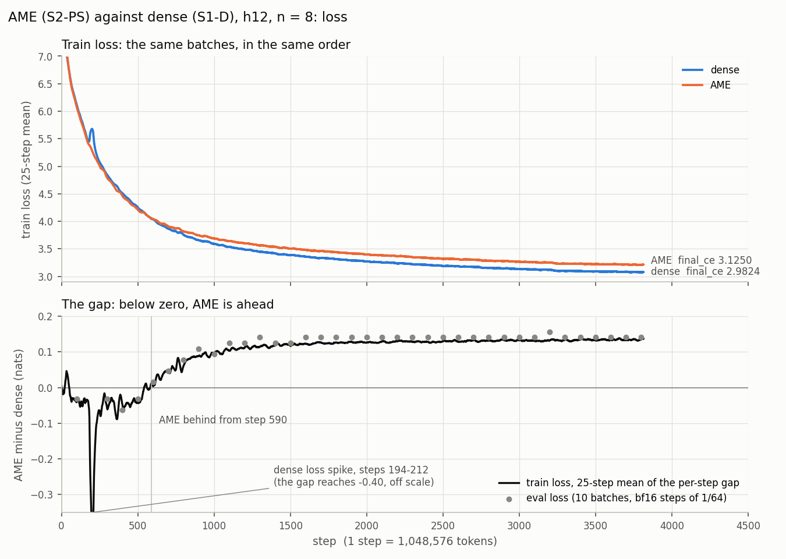
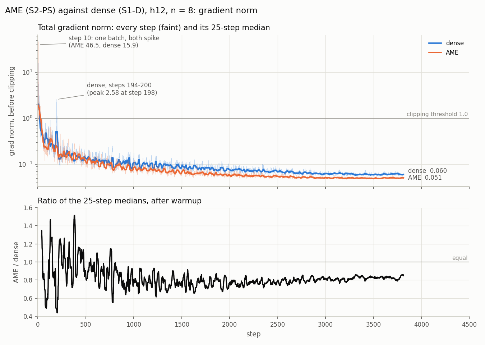
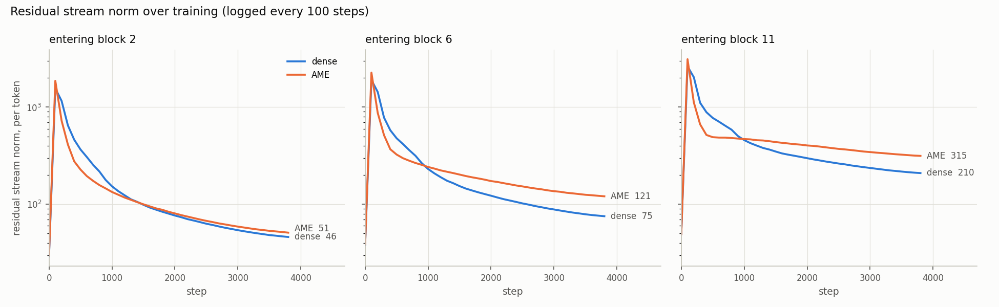
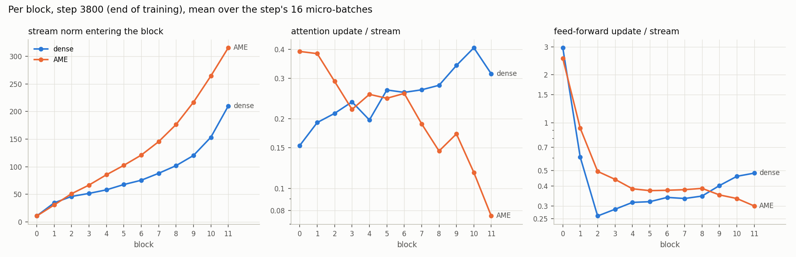
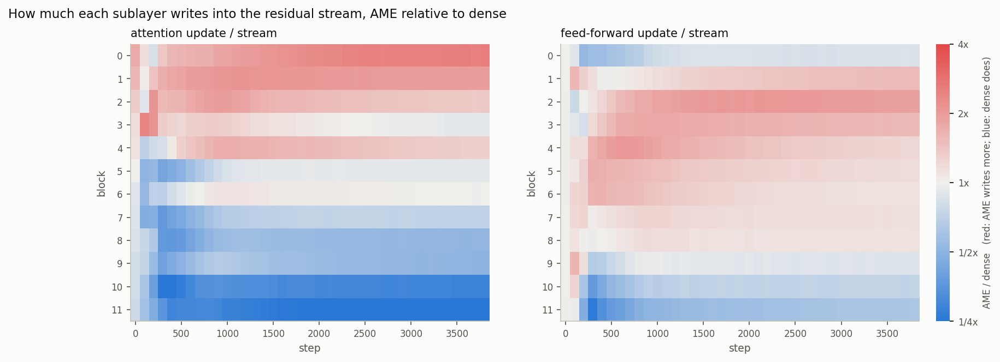
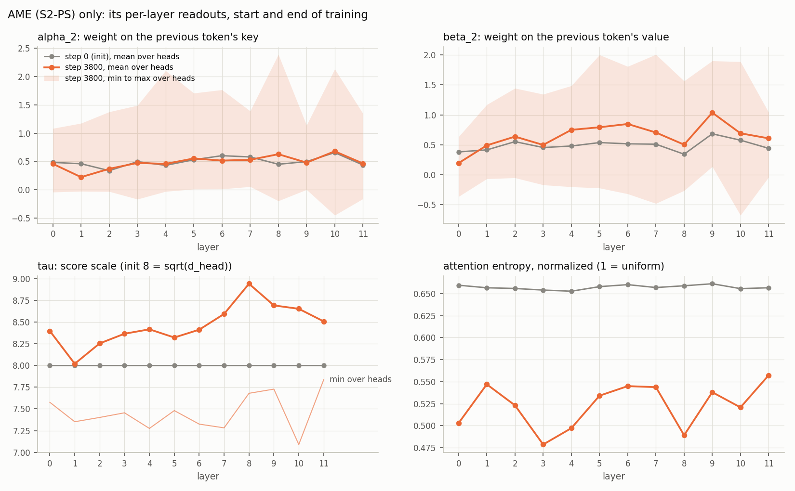

# AME against dense at h12: what the two best runs' training logs show

**Status (2026-11-06, 20:30 CET): angle 1, the training logs, is done.** The next angles
need the two final checkpoints; they are listed under [Next angles](#next-angles).

This is the working notebook for one comparison: the best AME run against the best
dense run at h12 and 4B tokens. It holds what we know (findings, with numbers),
what we think (hypotheses, each with its evidence and a test), what we guess
(speculation, labelled as such), and what to look at next. Other experiments are
cited only where they bear on these two runs.

- The numbers and figures come from
  [ame_comparison_h12.py](../scripts/ame_comparison_h12.py): `tables` prints every table
  here and `figures` redraws [ame_comparison_figures/](ame_comparison_figures/).
- The runs' own records are [stage_1_report.md](stage_1_report.md) (dense) and
  [stage_2_report.md](stage_2_report.md) (AME).
- The method is described in [ame_implementation.md](ame_implementation.md).

## The two runs

| | AME | dense |
|---|---|---|
| Arm | **S2-PS**: AME with ALiBi and the KV shift | **S1-D**: dense GQA with RoPE |
| W&B run (ideas_cv/nano-ame) | `doi36p8k`, s2_ps_h12_lr8.0 | `x0xlqroj`, s1_d_h12_lr8 |
| Slurm job, node | 6256577, r18-14 | 6252398_0, r12-3 |
| Code | `f9680709` (cemetery `3c8f550b`) | `8a240816` (cemetery `489342e2`); `src/` and `main.py` identical to `f9680709` |
| Learning rate | n = 8, LR = 2⁻⁸ = 3.91e-3 | n = 8, the same |
| **`final_ce`** | **3.1250** | **2.9824** |
| Parameters | 1,103.60M: banks 927.28M, backbone 99.05M, embedding and head 77.27M | 183.45M: backbone 106.19M, embedding and head 77.27M |
| Training GFLOP per token | 1.053 | 1.095 |
| s/step (median, steps ≥ 100) | 3.746 | 3.272 |
| Peak memory, wall time | 70.4 GiB, 4.20 h | 47.0 GiB, 3.70 h |
| Final checkpoint (cemetery clone under `/lustre/pd03/plgrid/plgllmefficont3/mstefaniak/llmrandom_cemetery/`) | `s2_ps_h12_lr8.0_2026-11-06_13-52-40/checkpoint/6256577/0/step_3814`, 13 GB with the bank state | `s1_d_h12_lrNone_2026-11-06_03-35-57/checkpoint/6252398/0/step_3814`, 2.1 GB |

**Both runs are at n = 8, not n = 9.** n = 9 is Maciej's working n\* for h12; these
are the best runs measured. The n = 9 pair is S2-PS `ublx3ion` (3.1865) and S1-D
`ovy19sqp` (3.0244), with the same gap to within 0.02 nats (0.162).

**What is shared.** These were read from the logged configs, not the YAML:

- the model: h12 (12 blocks, d_model 768, 12 query heads of 64, d_ff 3,072,
  vocabulary 50,304, untied embedding and head);
- the data: 3,815 steps × 512 × 2,048 = 4.00B tokens, data seed 123, so **both runs
  saw the same batches in the same order**;
- the optimizer: AdamW, weight decay 0.1, cosine schedule with 38 warmup steps down to
  10% of peak, gradient clipping at 1.0;
- the hardware and precision: autocast bf16, micro-batch 32 × 16, no FSDP2, one LEM
  H100.

AME's banks have their own AdamW. Its learning rate equals the backbone's at every
logged step, its weight decay is 0, and it is clipped jointly with the backbone
(memory_parallel.py, O4).

**What differs: the attention layer, nothing else.**

| | dense (S1-D) | AME (S2-PS) |
|---|---|---|
| Queries and keys | `W_Q·x`, `W_K·x`: read the hidden state | bank rows `E_Q[t]`, `E_K[t]`: token id only, ℓ2-normalized |
| K/V heads | 6 (GQA, 2 query heads per KV head) | 12 (MHA-shaped) |
| Score scale | fixed 1/√64, no QK-norm | learned τ per head, init 8, on unit vectors |
| Position | RoPE, base 10,000 | ALiBi ladder, one fixed slope per head, horizons 16 to 8,192 |
| KV shift | none | k̂ = α₁k + α₂k₋₁, v̂ = β₁v + β₂v₋₁, learned per head |
| Attention sink | none built in | a learned key and value per head, visible to every query |

So "dense" here differs from AME in five ways at once:

- where Q and K come from;
- the head count;
- the score normalization;
- the positional encoding;
- the shift and the sink.

The 0.143-nat gap belongs to the whole package.

## What the logs hold, and what they do not

| Logged | How often | Notes |
|---|---|---|
| `train/loss`, `train/lr`, `train/step_time` | every step | loss is bf16-rounded per step |
| `train/grad_norm` | every step | total norm before clipping at 1.0; **AME's includes the bank gradients**, so the two totals cover different parameter sets |
| `block[i]/residual_{attention,feedforward}/…` | every 100 steps | per-token ℓ2 norms, mean and std over all tokens of the step's 16 micro-batches (16 × 32 × 2,048 tokens): the stream entering the sublayer (`residual_norms`), the sublayer's output (`update_norms`), and their per-token ratio (`update_to_residual_ratio`) |
| `eval/loss` | every 100 steps | 10 batches, bf16-quantized: steps of 1/64 ≈ 0.016 near 3 |
| AME only: τ, α₂, β₂, horizons, attention entropy, top-8 mass | every 100 steps, per layer | entropy and top-8 mass come from one sequence of the last micro-batch, 128 query rows |
| `final_ce` | once | 8,192 × 2,048 held-out tokens; accurate to about 0.001 |

**Naming trap.** "update norms" here are the residual branches' outputs, what a
sublayer adds to the stream. They are not optimizer update norms ‖ΔW‖.

**Not logged**, so not answerable from the logs:

- per-parameter-group gradient norms;
- weight norms;
- optimizer step sizes;
- attention-logit magnitudes;
- any per-position statistic;
- dense's attention entropy;
- AME's α₁ and β₁ (only α₂ and β₂ are logged).

## Findings

### F1. The gap: 0.143 nats; dense matches AME's final loss at 58% of the run

`final_ce` is 3.1250 against 2.9824: AME is 0.1426 nats (4.8%) worse.

Dense's eval loss first reaches AME's final 3.125 at step ~2,200, which is 2.31B
tokens or 58% of the run. Its learning rate is then still 45% of peak. A dense run
whose schedule ended at 2.3B tokens would anneal lower still. So **AME's 4B tokens
are worth less than 2.3B dense tokens: AME needs more than 1.7× the data for the
same loss**, at this size and this n.

### F2. AME leads for the first 590 steps, then falls behind, and the gap keeps widening slowly

The two runs saw identical batches, so the per-step train-loss difference is free of
batch-to-batch noise.

| Steps | Gap, AME − dense (mean of the per-step train-loss difference) | Steps where AME is lower |
|---|---:|---:|
| 0–37 (warmup) | +0.012 | 34% |
| 38–99 | −0.022 | 65% |
| 100–299 | −0.097 (−0.045 without dense's spike, steps 185–230) | 88% |
| 300–599 | −0.035 | 73% |
| 600–999 | +0.065 | 0% |
| 1000–1499 | +0.112 | 0% |
| 1500–1999 | +0.124 | 0% |
| 2000–2499 | +0.128 | 0% |
| 2500–2999 | +0.131 | 0% |
| 3000–3499 | +0.132 | 0% |
| 3500–3814 | +0.134 | 0% |

- **Early lead.** From step 38 to step 590, AME is ahead by 0.036 on average,
  leaving out dense's spike (F3). Its largest lead, as a 50-step mean, is 0.063 at
  step ~350.
- **The crossover is at step 590**, 0.62B tokens. That is the first step after which
  the 50-step mean gap stays above zero.
- **The gap opens fast and keeps opening slowly.** About 0.11 nats of it forms
  between steps 600 and 1,500. Over steps 1,500–3,814 a linear fit gives
  **+0.005 nats per 1,000 steps**. Within this run the gap does not close; AME's
  deficit is not a slower start that more data erases.
- The bf16-quantized evals agree: the gap is 0.141 at every eval from step 1,600 on,
  except 0.156 at step 3,200.

### F3. Stability: dense spiked once at peak learning rate; AME never did after warmup

- **Step 10 (warmup, LR 1.3e-3): both runs spike on the same batch.** The gradient
  norm is 46.5 in AME and 15.9 in dense, and the loss jumps 7.66 → 8.25 in both. Both
  recover the next step. The batch is shared, so the trigger is the data; AME's
  gradient reacts about 3× harder.
- **Warmup clipping.** AME clipped 29 of the 38 warmup steps, dense 20.
- **After warmup, AME never reaches the clipping threshold.** Its largest gradient
  norm is 0.96 at step 41, and nothing exceeds 0.65 after step 100.
- **Dense has a loss spike at steps 194–212, at peak LR.**
  - Train loss goes 5.47 (step 188) → 6.50 (step 198) and is back by step ~212.
  - Steps 196, 197, 198 and 200 are clipped; the peak gradient norm is 2.58.
  - The step-200 eval caught it mid-spike: 5.69 against AME's 5.16.
- **By stage_1_report.md's own spike rule, this is a spike there too.** The rule is a
  train loss more than 0.5 above the median of the previous 50 steps; on the full
  history, steps 196 (+0.66) and 198 (+0.97) qualify. The report's stability table
  (decision 9) records "no spike" for this run. AME passes the same rule with a
  largest excess of +0.07.

### F4. AME's gradient norm runs at about 0.8× dense's for the whole second half

| Steps | Median grad norm, AME | Median grad norm, dense | AME / dense |
|---|---:|---:|---:|
| 38–99 | 0.265 | 0.395 | 0.67 |
| 100–299 | 0.211 | 0.213 | 0.99 |
| 300–599 | 0.131 | 0.141 | 0.93 |
| 600–999 | 0.092 | 0.110 | 0.83 |
| 1000–1499 | 0.073 | 0.096 | 0.77 |
| 1500–1999 | 0.062 | 0.082 | 0.76 |
| 2000–2499 | 0.056 | 0.073 | 0.77 |
| 2500–2999 | 0.052 | 0.065 | 0.80 |
| 3000–3499 | 0.050 | 0.061 | 0.82 |
| 3500–3814 | 0.050 | 0.061 | 0.82 |

Both fall steadily to the end. Neither shows the late-training rise that weight decay
and a decaying learning rate sometimes produce. The ratio settles near 0.77 by step
1,000 and drifts to 0.82–0.86 by the end. AME's total includes the banks and lacks
W_Q and W_K, so it covers a different parameter set. Which group carries the
difference is not logged. One explanation was checked against the logs and does not
hold: H5.

### F5. AME's residual stream ends 1.3–1.8× larger from block 3 on

- **At init the two match**: the stream grows from 24 to 49 across depth in both.
- **Within 100 steps both blow up** to 500–3,100, driven by the first two feed-forward
  blocks. At step 100 their outputs have norms of 526 and 1,481 in AME, and 621 and
  1,099 in dense. Weight decay then shrinks everything for the rest of the run.
- **AME's stream first shrinks faster, then slower.** It is smaller than dense's from
  step ~200 to ~1,000. It then stays larger: from step 1,000 in blocks 5–11, and from
  steps 1,100, 1,200 and 1,500 in blocks 4, 3 and 2.
- **At the end** the stream entering block 11 is 315 in AME against 210 in dense.
  Blocks 0–1 match (0.99×, 0.89×).

### F6. Attention: AME writes more than dense in the first three blocks and much less in the last five

The update/stream ratio is the per-token ‖sublayer output‖ / ‖stream entering it‖: how
much the sublayer changes the stream.

| Block | Stream norm entering the block, AME / dense | Attention output norm, AME / dense | **Attention update/stream, AME / dense** | Feed-forward output norm, AME / dense | **Feed-forward update/stream, AME / dense** |
|---|---|---|---|---|---|
| 0 | 11 / 11 (0.99×) | 4.1 / 1.6 (2.53×) | **0.392 / 0.153 (2.56×)** | 28.7 / 32.7 (0.88×) | 2.531 / 2.956 (0.86×) |
| 1 | 31 / 35 (0.89×) | 11.6 / 6.2 (1.85×) | **0.384 / 0.193 (1.99×)** | 30.5 / 19.6 (1.56×) | 0.924 / 0.608 (1.52×) |
| 2 | 51 / 46 (1.11×) | 13.9 / 9.4 (1.48×) | **0.291 / 0.211 (1.38×)** | 26.0 / 12.1 (2.15×) | 0.494 / 0.259 (1.91×) |
| 3 | 67 / 52 (1.29×) | 14.0 / 11.5 (1.22×) | 0.220 / 0.237 (0.93×) | 30.2 / 15.2 (1.99×) | 0.441 / 0.286 (1.54×) |
| 4 | 85 / 58 (1.47×) | 20.8 / 10.9 (1.92×) | 0.256 / 0.198 (1.29×) | 32.9 / 19.2 (1.71×) | 0.384 / 0.316 (1.22×) |
| 5 | 102 / 68 (1.51×) | 24.6 / 17.4 (1.41×) | 0.246 / 0.267 (0.92×) | 39.5 / 22.0 (1.79×) | 0.374 / 0.319 (1.17×) |
| 6 | 121 / 75 (1.60×) | 30.3 / 18.8 (1.61×) | 0.258 / 0.261 (0.99×) | 48.3 / 27.2 (1.77×) | 0.376 / 0.339 (1.11×) |
| 7 | 145 / 88 (1.65×) | 27.3 / 22.6 (1.21×) | **0.190 / 0.267 (0.71×)** | 58.4 / 30.8 (1.90×) | 0.379 / 0.334 (1.14×) |
| 8 | 176 / 102 (1.73×) | 25.4 / 27.1 (0.94×) | **0.145 / 0.280 (0.52×)** | 71.8 / 37.6 (1.91×) | 0.387 / 0.346 (1.12×) |
| 9 | 217 / 120 (1.80×) | 36.8 / 39.4 (0.93×) | **0.172 / 0.341 (0.50×)** | 81.0 / 52.5 (1.54×) | 0.352 / 0.402 (0.87×) |
| 10 | 264 / 153 (1.72×) | 30.4 / 60.2 (0.51×) | **0.117 / 0.407 (0.29×)** | 92.8 / 82.2 (1.13×) | 0.334 / 0.460 (0.73×) |
| 11 | 315 / 210 (1.50×) | 23.3 / 64.8 (0.36×) | **0.076 / 0.314 (0.24×)** | 100.3 / 118.0 (0.85×) | 0.300 / 0.482 (0.62×) |

- **Opposite slopes with depth.** Dense's attention changes the stream more the deeper
  it sits, from 0.15 at block 0 to 0.41 at block 10. AME's changes it less, from 0.39
  to 0.08.
- **Early blocks.** In blocks 0–2 AME's attention writes 1.4–2.6× as much as dense's.
- **Middle blocks.** Blocks 3–6 are within 0.9–1.3×.
- **Late blocks.** In blocks 7–11 AME's attention writes 0.24–0.71× as much. In blocks
  10 and 11 even the absolute output is a half and a third of dense's, although
  AME's stream there is 1.5–1.7× larger.

The pattern is set by step ~300 and holds from step ~1,000 to the end. That is the
window in which the loss gap opens (F2).

### F7. Feed-forward: AME's blocks 1–8 write more, its last three less

Relative to the stream, AME's feed-forward blocks 1–8 write 1.1–1.9× as much as
dense's; their absolute outputs are 1.5–2.2× larger. Blocks 9–11 write 0.62–0.87× as
much, and block 0 0.86×. The larger mid-depth writes are what make AME's stream grow
faster with depth (F5).

### F8. Dense's stream and late-attention writes vary far more from token to token

Coefficient of variation (std / mean over all tokens of step 3,800) per block:

| Block | Stream norm, AME / dense | Attention output, AME / dense | Attention update/stream std, AME / dense | Feed-forward output, AME / dense |
|---|---|---|---|---|
| 0 | 0.05 / 0.03 | 0.43 / 1.02 | 0.179 / 0.158 | 0.20 / 0.34 |
| 1 | 0.19 / 0.32 | 0.16 / 0.47 | 0.073 / 0.115 | 0.51 / 0.75 |
| 2 | 0.29 / 0.30 | 0.24 / 0.43 | 0.101 / 0.095 | 0.33 / 0.63 |
| 3 | 0.25 / 0.28 | 0.37 / 0.28 | 0.083 / 0.089 | 0.31 / 0.47 |
| 4 | 0.23 / 0.26 | 0.28 / 0.28 | 0.083 / 0.073 | 0.35 / 1.01 |
| 5 | 0.20 / 0.42 | 0.22 / 0.21 | 0.054 / 0.063 | 0.28 / 0.32 |
| 6 | 0.17 / 0.38 | 0.15 / 0.19 | 0.054 / 0.065 | 0.26 / 0.81 |
| 7 | 0.14 / 0.54 | 0.15 / 0.20 | 0.032 / 0.060 | 0.28 / 0.34 |
| 8 | 0.12 / 0.49 | 0.17 / 0.20 | 0.027 / 0.077 | 0.29 / 0.74 |
| 9 | 0.13 / 0.57 | 0.17 / 0.23 | 0.034 / 0.086 | 0.31 / 0.21 |
| 10 | 0.14 / 0.45 | 0.12 / 0.29 | 0.020 / 0.137 | 0.35 / 0.28 |
| 11 | 0.17 / 0.28 | 0.18 / 0.18 | 0.018 / 0.060 | 1.27 / 0.44 |

- **The stream.** In blocks 5–10 dense's stream norm varies 2–4.5× more across tokens
  than AME's (CV 0.38–0.57 against 0.12–0.20). Dense's feed-forward outputs in blocks
  4, 6 and 8 are bursty (CV 0.74–1.01). Together that reads as a few tokens carrying
  much larger norms than the rest. This is the clearest token-level difference in the
  logs.
- **Late attention: a smaller difference than it first looks.** In blocks 7–11 the
  std of the attention update/stream ratio is 0.018–0.034 in AME against 0.060–0.137
  in dense. Most of that comes from AME's smaller mean. Relative to the mean the
  spread is 0.17–0.24 in AME against 0.19–0.34 in dense, so AME's late attention is
  only somewhat more uniform across tokens. Block 10 is the clear case: 0.17 against
  0.34.

### F9. AME's own readouts: τ barely moves, α₂ holds, β₂ grows in the middle layers

| Layer | τ | α₂ mean | \|α₂\| mean | β₂ mean | Entropy, normalized | Top-8 mass |
|---|---|---|---|---|---|---|
| 0 | 8.00 → 8.40 | 0.48 → 0.46 | 0.48 → 0.47 | 0.38 → 0.20 | 0.66 → 0.50 | 0.41 → 0.58 |
| 1 | 8.00 → 8.02 | 0.46 → 0.22 | 0.46 → 0.23 | 0.42 → 0.49 | 0.66 → 0.55 | 0.41 → 0.53 |
| 2 | 8.00 → 8.25 | 0.34 → 0.37 | 0.34 → 0.37 | 0.55 → 0.64 | 0.66 → 0.52 | 0.42 → 0.58 |
| 3 | 8.00 → 8.37 | 0.50 → 0.47 | 0.50 → 0.50 | 0.46 → 0.50 | 0.65 → 0.48 | 0.42 → 0.65 |
| 4 | 8.00 → 8.42 | 0.43 → 0.46 | 0.43 → 0.46 | 0.48 → 0.75 | 0.65 → 0.50 | 0.42 → 0.60 |
| 5 | 8.00 → 8.32 | 0.53 → 0.55 | 0.53 → 0.55 | 0.54 → 0.79 | 0.66 → 0.53 | 0.41 → 0.56 |
| 6 | 8.00 → 8.41 | 0.60 → 0.52 | 0.60 → 0.52 | 0.52 → 0.85 | 0.66 → 0.54 | 0.41 → 0.55 |
| 7 | 8.00 → 8.59 | 0.58 → 0.53 | 0.58 → 0.53 | 0.51 → 0.71 | 0.66 → 0.54 | 0.41 → 0.55 |
| 8 | 8.00 → 8.94 | 0.45 → 0.63 | 0.45 → 0.66 | 0.34 → 0.50 | 0.66 → 0.49 | 0.41 → 0.61 |
| 9 | 8.00 → 8.69 | 0.50 → 0.48 | 0.50 → 0.48 | 0.68 → 1.04 | 0.66 → 0.54 | 0.41 → 0.55 |
| 10 | 8.00 → 8.65 | 0.66 → 0.68 | 0.66 → 0.76 | 0.58 → 0.69 | 0.66 → 0.52 | 0.42 → 0.58 |
| 11 | 8.00 → 8.51 | 0.44 → 0.46 | 0.44 → 0.51 | 0.44 → 0.61 | 0.66 → 0.56 | 0.42 → 0.52 |

- **τ** ends at 8.0–8.9 per layer, with a minimum over heads of 7.1–7.8. The score
  scale it sets hardly moved, so the horizon ladder stays about 14–16 to 7,800–9,100
  tokens.
- **α₂**, the weight on the previous token's key, keeps its init mean of about 0.5,
  except in layer 1 (0.46 → 0.22) and layer 8 (0.45 → 0.63). Across heads it spread
  out, from −0.45 to 2.39. Nothing collapsed: the shift is in use in every layer.
- **β₂**, the weight on the previous token's value, grew in layers 4–9: to 0.71–1.04
  in layers 4–7 and 9, and from 0.34 to 0.50 in layer 8. In layer 0 it fell from 0.38
  to 0.20. β₁ is not logged, so the balance between the two is unknown.
- **Attention is diffuse.** The normalized entropy fell from 0.66 to 0.48–0.56. At
  query row 1,000, 0.5 means about e^(0.5·ln 1000) ≈ 32 keys' worth of spread. The top
  8 keys hold 52–65% of the mass. There is no dense counterpart in the logs.

### F10. Cost

AME runs 14.5% slower per step: 3.746 s against 3.272 s, despite 4% fewer FLOPs per
token. It needs 1.5× the peak memory, 70.4 against 47.0 GiB. About two-thirds of the
23 GiB difference is the banks' state. For 927M parameters, a bf16 compute copy, an
fp32 master, an fp32 gradient buffer and two Adam moments come to 18 bytes each,
about 15.5 GiB. Both figures are from LEM. The step-time breakdown is in
[ame_implementation.md](ame_implementation.md), "Step time, after the kernel was
fixed".

### F11. The gap is not the efficiency implementation's

The efficiency-parity audit checked every AME-only MFU change active in S2-PS against a
plain implementation and against dense's own rounding. The plan is
[ame_efficiency_parity_plan.md](ame_efficiency_parity_plan.md) and the record
[ame_efficiency_parity_report.md](ame_efficiency_parity_report.md). The changes:

- Tier 2 banks and their bf16 compute copy;
- the traced fused Q/K gather;
- flex with ALiBi;
- the sink as an LSE merge;
- tau folded into q;
- the compiled block;
- the sidecar.

What it found:

- **The gap is 0.1426 nats under every evaluator**, the fp32 reference path included:
  - fp32 reference: 3.125227 against 2.982607;
  - production forward, precise: 3.125377 against 2.982760;
  - the Trainer's own number: 3.125 against 2.982421875.

  Each arm's production stack costs it the same 0.00015 against its fp32 oracle. The
  implementation's share at the loss level is under 1e-5.
- **No bug.** The bank gradient's structure is exact at init and at the end, the
  gradient through flex's LSE is right, and the Tier 2 optimizer step equals the ordinary
  fused AdamW to 1e-7.
- **Every item's gradient error is within dense's rounding budget**, and two are exact.
  The kernel is more accurate than a plain bf16 implementation.
- **No harm in training at 220-300 steps.** At 300 steps, production trains, if
  anything, *better* than the same model with fp32 banks: 7 runs against 6, a difference
  of −0.12 nats, at most +0.03 at 95%.
- **Effects that need thousands of steps are not measured.** Full-length runs are
  prepared, not run.
- **Short AME runs are chaotic.** Identical 300-step runs spread with an sd of about 0.12
  nats, set mostly by small loss bumps in steps 25-50, just before the LR peak. Any short
  A/B on AME needs ≥ 5 runs per arm.
- **The step-10 gradient-norm spike (F3) appears in every AME configuration**: 45-49,
  including G-REF with Tier 2, flex and the LSE merge all off. It is the method's, not an
  implementation artifact.
- **One AME-specific numerical weakness, from the bf16 policy both arms share.** Late in
  training, the gradients of alpha, beta and tau are 9-31% off in *every* bf16
  implementation of AME. The cause is the bf16 attention backward, amplified by
  cancellation in the per-head sums. Its training effect is unmeasured (report, Q2).

## Hypotheses

Status: **open** = consistent with the logs, needs a test; **weakened** = some
evidence against; **not supported** = checked against the logs and failed.

| | Hypothesis | Evidence for | Evidence against, or missing | Test | Status |
|---|---|---|---|---|---|
| **H1** | **AME loses in the late layers, where attention needs content.** Dense's deeper layers do content-addressed attention. AME's scores see only token ids, distance and the previous id, so it cannot, and it mostly stops using its late attention. The 0.143 nats are largely the value of contextual Q/K in blocks 7–11 | Attention update/stream 0.24–0.71× dense's in blocks 7–11, and only a third to a half of dense's absolute output in blocks 10–11 (F6). This pattern forms at steps 300–1,000, when the gap opens (F2). AME's late attention is somewhat more uniform across tokens, clearly so in block 10 (F8). The design predicts it: "the weights never read a hidden state, so retrieval is never content-addressed" (ame_implementation.md) | Write size is not usefulness: a small write can matter and a large one can be noise. The per-block metrics mix all positions and tokens | A1 (ablate each attention layer), A2 (where the loss is lost) | open |
| **H2** | **AME's mid-depth feed-forward blocks take on work its attention cannot do** | FF outputs 1.5–2.2× dense's in blocks 1–8 (F7). The larger stream follows from them (F5) | A feed-forward block acts on one position, so it cannot fetch context; it can only reuse what attention brought in. Larger writes may only mean larger weights | A4 (weight norms per block), A5 (logit lens) | open |
| **H3** | **AME's early lead is a built-in prior.** Id-indexed scores, a fixed ALiBi ladder, the shift and a sink give useful local, n-gram-like attention from step 0; dense must first learn W_Q, W_K and how to use RoPE | AME is ahead for steps 38–590 (F2). Its attention writes most in blocks 0–2 (F6) | The early lead is small (0.036 on average) and includes dense's spike period. One seed each | Compare the step-0 to step-500 curves with S2-D0 (dense NoPE), already logged | open |
| **H4** | **AME did not spike because its scores are bounded**: unit Q and K times τ ≈ 8, so the attention logits cannot grow, a known spike mechanism (Dehghani et al. 2023; Wortsman et al. 2023). Dense has no QK-norm | Dense spiked at peak LR, AME did not (F3) | S1-A0, AME with the same QK-norm, τ and sink but no ALiBi or shift, spiked at n = 8 (steps 1,117–1,141, to 7.50) and n = 9 (steps 609–635, to 14.69) (stage_1_report.md). So bounded scores alone do not prevent spikes. Also, α can scale keys past τ's bound (S3) | Log attention-logit maxima per layer (not logged), or train dense with QK-norm (an experiment, outside this comparison) | weakened |
| **H5** | **AME's lower gradient norm comes from its larger final stream**: RMSNorm's backward divides by the input norm, so a stream 1.3× larger gives gradients about 0.77× as large | At the end the prediction is 0.76–0.80 and the observed ratio 0.82–0.86. The prediction comes from the stream entering block 11's FF, 1.32× dense's, with or without its FF output added | Until step ~1,000 AME's final stream is the smaller one (0.53–0.79× at steps 200–800), so the explanation predicts a larger AME gradient norm (1.3–1.9×). The observed ratio is 0.45–0.96. The ratio stays at 0.78–0.86 from step 1,000 on while the stream ratio climbs from 0.98 to 1.32 | — | **not supported**: it fits only the end, which looks like coincidence |
| **H6** | **The gap grows with data**: AME's deficit is a worse ceiling, not a slower start | +0.005 nats per 1,000 steps over the second half (F2) | Small, within one run, partly inside the cosine anneal | Stage 2b (h16, 8B tokens), when it finishes, without new runs | open |
| **H7** | **Dense builds its own attention sink out of a few large-norm tokens; AME has one built in** | Dense's stream CV is 2–4× AME's in blocks 5–10, and its FF writes are bursty in blocks 4, 6 and 8 (F8). AME has a learned sink key and value per head; dense has none. Sinks on high-norm tokens are the known dense pattern (Xiao et al. 2023; Sun et al. 2024) | The logs have no per-position or per-token data, so which tokens carry the large norms is unknown | A3 (per-position stream norms and attention to position 0, both models) | open |
| **H8** | **Part of the gap is AME's efficiency implementation, not the method.** AME's layer and bank path carry about 40 MFU changes that dense lacks, several of them changing precision, the kernel, the gradient path or the optimizer | The changes were gated for throughput, mostly at toy shapes in float64, never for training quality | The audit (F11). The gap is 0.1426 under an fp32 evaluator. Every AME-only change is within dense's rounding budget or exact; no bug. At 300 steps production trains no worse than a plain implementation (≤ +0.03 nats at 95%). Late-training effects were not testable in 300-step gates | Proposed full-length runs P0, P0r, P0b, P1, P-REF, D0 (report) | **not supported**, as far as checks and 220-300-step gates reach |

## Speculation

Each item would explain something, and none is supported by more than the logs.

- **S1. The gap may grow with model size, not only with data.** Content-addressed
  retrieval matters more in larger models and longer contexts. If H1 holds, the share
  of late layers that AME cannot use well does not shrink with scale. Stage 2b's h16
  numbers will be the first evidence, though they are another experiment.
- **S2. AME's heads act more as smoothed local features than as pointers.** Entropy
  of about 0.5 and top-8 mass of about 0.6 (F9) suggest bag-of-recent-tokens averaging
  rather than the near-one-hot heads, such as previous-token and induction heads, that
  dense models grow. The early-block write excess (F6) would be that averaging doing
  n-gram-like work.
- **S3. AME sharpens through α, not τ.** With unit bank rows, |k̂| ≤ |α₁| + |α₂|, so
  a head with α₂ near 2.4 can reach scores about 3× beyond what τ alone allows.
  τ's near-stillness (F9) need not mean the scale is fixed. α₁ is not logged, so this
  needs the checkpoint (A6).
- **S4. Mid-depth AME reads may return more of the matched position's predecessor than
  of the position itself.** β₂ grew to 0.71–1.04 in layers 4–7 and 9. If β₁ stayed
  near its init (β₁ + β₂ = 1 at init), the predecessor's value outweighs the
  position's own. With α₂ ≈ 0.5 these heads would be part "match my predecessor" and
  part "match me", each returning a blend of two positions. This needs β₁ from the
  checkpoint (A6).
- **S5. Dense's step-194–212 spike falls inside the window where its stream norms are
  largest and shrinking fastest** (F5): step 100 to 300 in blocks 1–11. Forming an
  attention sink out of large-norm tokens (H7) is one candidate trigger; AME, with its
  sink built in, would not need to.

## Caveats

- **One seed per arm.** There is no seed repeat of S1-D or S2-PS at n = 8.
  - The only h12 seed gap measured is S1-A0 against S2-N at n = 9: 0.232, and that
    is inflated by S1-A0's spike ([stage_2_report.md](stage_2_report.md)).
  - A gap of 0.143 that is steady for 2,500 steps of paired batches is not noise. The
    early lead (0.036) and the trajectory details could be.
- **AME's learning rate is not bracketed.** S2-PS ran at n = 8, 9 and 10, and n = 8
  is the edge. AME's simplest arm S1-A0 kept improving to n = 6 in Stage 1. These
  logs also say AME has headroom at n = 8: lower gradient norm, no clipping after
  warmup, no spike. Dense's n = 8 is bracketed (n = 7 was worse). So 0.143 is an
  upper bound on the gap at the two arms' optimal learning rates.
- **The eval loss is bf16-quantized**, in steps of 1/64. Use `final_ce` and the paired
  train loss. The paired train gap at the end (+0.134) sits a little under the
  `final_ce` gap (+0.143). The train losses are bf16-rounded per step, and the
  held-out set is a different sample.
- **The per-block metrics are means over every token and position** of one step every
  100. They include position 0, where the shift brings in zeros.
- **AME's entropy and top-8 mass come from one sequence and 128 query rows** every
  100 steps, so they are noisy.
- **The two gradient-norm totals cover different parameter sets** (F4).

## Next angles

In order of how much each would tell us. A1–A6 need the two final checkpoints (paths
in [The two runs](#the-two-runs)); none needs a new training run.

1. **A1. Per-layer attention ablation.** Replace each layer's attention output with
   its mean (or zero) and measure the held-out loss change, layer by layer, in both
   models. This is H1's direct test: how much each layer's attention is worth in each
   model. Does dense lose most from its late layers, and does AME lose little from
   its own?
2. **A2. Where the 0.143 nats are lost.** Compute the per-token loss difference on the
   same held-out sequences, then split it:
   - by position in the context: long-range retrieval should cost more at later
     positions;
   - by whether the token appeared earlier in the context (copyable or inducible
     against novel);
   - by token frequency.

   This turns "AME is worse" into "AME is worse at X".
3. **A3. Dense's attention and stream by position**, with AME's own definitions:
   - normalized entropy and top-8 mass per layer, on the same tokens;
   - attention mass on position 0 (dense) and on the sink (AME);
   - stream norm per position and per token.

   This tests H7 and S2.
4. **A4. Weight norms and gradient norms per parameter group**: W_V, W_O, the FF in
   and out matrices, embedding, head and banks, from the checkpoints and a few
   batches. This explains F4 and tests H2.
5. **A5. Logit lens by depth.** Find the block at which each model's prediction
   forms. If AME relies on its mid-depth feed-forward blocks (H2), its predictions may
   form earlier.
6. **A6. AME's α₁ and β₁ and the effective score scale** τ·|k̂| per head, from the
   checkpoint. This tests S3 and S4.

## For Maciej

1. **These two runs are at n = 8, not 9.** The n = 9 pair has the same story by
   `final_ce`: a gap of 0.162. Say if you want this analysis repeated on it.
2. **AME's learning rate is not bracketed** (see Caveats). S2-PS at n = 7 would settle
   whether the gap shrinks at AME's own optimum: one H100 for about 4.2 h. That
   belongs to the experiment session; it is noted here because the gap's size depends
   on it.
3. **stage_1_report.md's stability table is wrong for dense n = 8** (F3). That table
   is in decision 9, which backed your n = 9 choice. By the report's own rule, steps
   196 and 198 of `x0xlqroj` are a spike. That supports n = 9 for dense. The report
   was not edited from this session.

## Log

- **2026-11-06 20:30.** Angle 1, the training logs.
  - Fetched both runs' full W&B histories: 3,816 rows each, every step.
  - Confirmed from the logged configs that only the attention layer differs, and
    that `src/` is identical at the two commits.
  - Wrote [ame_comparison_h12.py](../scripts/ame_comparison_h12.py) and the six
    figures, and recorded F1–F10, H1–H7, S1–S5 and A1–A6.
  - Checked H5 against the logs and rejected it.
  - Found the dense spike that stage_1_report.md missed.
- **2026-11-06 23:50.** The efficiency-parity audit
  ([ame_efficiency_parity_report.md](ame_efficiency_parity_report.md)) added F11 and H8
  (not supported).
