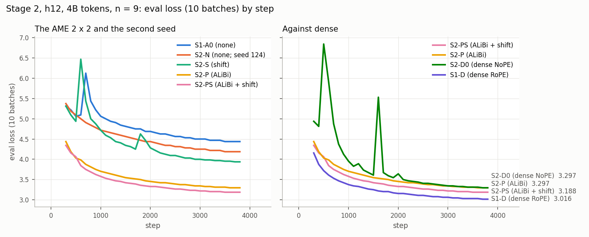

# Stage 2 — positional encoding and the shift: report

**Status: wave 1, S2-D0 and the learning-rate check have finished. S2-PS, ALiBi with the
shift, is best, provisionally; its best n moved to 8 (3.1250). By the plan's rule, S2-P and
S2-S re-run at n = 8 (wave 3, jobs 6259007 and 6259008) before a winner is named.**

The plan is [ame_experiments.md, "Stage 2 — positional encoding and the shift"](ame_experiments.md#stage-2--positional-encoding-and-the-shift).
This file is its record: every job, result and decision, each with its reason. Times are
CET. Stage 1's record, which supplies the reference cell S1-A0 and the dense baseline
S1-D, is [stage_1_report.md](stage_1_report.md).

## Setup

| | |
|---|---|
| Question | Which AME variant is best at h12 and 4B tokens: with positional encoding, with the KV shift, or with both? And how much does each one add? |
| Design | The 2 × 2 of {no positional encoding, ALiBi} × {no shift, KV shift}. S1-A0 (neither) comes from Stage 1; S2-P, S2-S and S2-PS are trained here; S2-N repeats S1-A0 with seed 124 as the noise floor |
| Positional encoding | The implemented ALiBi ladder: one fixed slope per head, horizons 16 to 8,192 tokens over 12 heads. No Stage 0 replacement was proposed before the start |
| Code and configs | Commit **`f9680709`** on `ame_main`, for every Stage 2 run. Its code is identical to Stage 1's `8a240816`: between them, only docs, the Stage 1b–2b configs and the four `learning_rate: 9` lines changed. Jobs are submitted from a clean worktree of their own, `~/code/nano-stage2` (branch `stage2_lem`). Stage 1's worktree stays at `8a240816` |
| Configs | [ame_h12_pe.yaml](../../configs/stage_2/ame_h12_pe.yaml) (S2-P), [ame_h12_shift.yaml](../../configs/stage_2/ame_h12_shift.yaml) (S2-S), [ame_h12_pe_shift.yaml](../../configs/stage_2/ame_h12_pe_shift.yaml) (S2-PS), [ame_h12_simplest_seed2.yaml](../../configs/stage_2/ame_h12_simplest_seed2.yaml) (S2-N) |
| Cluster, recipe | As in Stage 1: LEM, 1 H100 SXM5 94 GB per run, no FSDP2, autocast bf16, micro-batch 32 × 16, 3,815 steps = 4.00B tokens, seed 123 (S2-N: 124), r16-11 excluded, 7 h limit passed at submit ([stage_1_report.md](stage_1_report.md), decisions 3–4) |

## Decisions

1. **n\* = 9, by Maciej's call (2026-11-06, about 09:30), before Stage 1 settled.** His
   words: "Submit h12 experiments from stage 2, assume that LR 9 is the optimal one for
   both dense and ame … we can submit experiments from stage 2 and resubmit if we get
   different conclusions from stage 1." The four files set `learning_rate: 9`, committed
   in `f9680709`.

   At that moment Stage 1 stood like this
   ([stage_1_report.md](stage_1_report.md)):
   - n = 8 had beaten n = 9 in both arms: 2.9824 against 3.0244 for dense, 4.3711
     against 4.4316 for AME;
   - n = 7 (both arms) and n = 6 (AME) were still training.

   So Stage 1's final n\* may well differ from 9. If it does, the plan's rule decides the
   re-run: Stage 2's three arms and S2-N go again at Stage 1's n\*. Until then, the
   learning-rate check of Stage 2 itself (the best arm at n\* ± 1 = 8 and 10) still runs
   as the plan says. It measures directly whether n = 8 beats n = 9 for the winning arm.

   **Confirmed at about 10:00.** Maciej set n = 9 as the h12 optimum ("very close to lr 8
   but i prefere lr 9 for stability"; [stage_1_report.md](stage_1_report.md),
   decision 9). So n\* = 9 is final, and wave 1 stands as submitted.
2. **`run_exp.py` cannot finish a submit whose run name contains a dot, so `sbatch` was
   run by hand.** The W&B names read `s2_<arm>_h12_lr9.0`, as the plan predicts, because
   the schema types the learning rate as a float. `run_exp.py` uses the same string as a
   tmux session name. tmux turns the `.` into `_` when it creates the session, then reads
   the `.` in `tmux send -t <name>.0` as a pane separator, and fails with
   `can't find pane: 0_2026-11-06_09-33-22.0` before `sbatch` runs. Each clone was already
   complete, with the secrets substituted into `exp.job`. So `cd <clone> && sbatch exp.job`
   on LEM is exactly the step that was skipped. No code was changed. The fix is for
   Maciej ("For Maciej" below).
3. **An extra arm, S2-D0: dense h12 with no positional encoding, at Maciej's request
   (2026-11-06, about 09:45).** His words: "Run also as a baseline dense h12 for 4B
   tokens, but without any positional encoding - no rope or anything."
   - **Why it matters.** S2-D0 is S1-D with RoPE removed, so the causal mask is its only
     positional signal. It is the dense counterpart of S1-A0 and S2-S, which have no
     positional encoding either. So S1-A0 against S2-D0 isolates "Q and K from
     id-indexed banks" from "no position". This is one of the controls the plan defers
     to [ame_implementation.md](ame_implementation.md#positional-encoding-and-what-a-dense-comparison-must-control).
   - **A code change was needed.** `RoPEAttention` always applied RoPE, and no
     `rope_base` switches it off: the first frequency pair rotates at 1 rad/token at any
     base. The change gives gqa an options block, as ame has:
     `attention: {type: gqa, gqa: {rope: false}}`, in commit **`c4cb1ef6`**.
   - **The default is untouched.** With `rope: true`, or with no block at all, the
     layer is the S1-D layer bit for bit, and the state dict is unchanged, since RoPE has
     no parameters. So no existing dense run is affected, and S1-D needs no re-run.
     Tests cover it. Unknown options are rejected; `rope: true` equals the default bit
     for bit; and `rope: false` changes no parameter and makes a later token's output
     blind to the order of the tokens before it. The repo's CI test selection passes.
   - **Learning rate.** n = 9, Maciej's working n\* for every h12 model
     (decision 1). It is the S1-D point S2-D0 is compared at: S1-D scored 3.0244 at
     n = 9.
   - **Pre-flight.** The config composes, passes the schema check, and builds at
     S1-D's 183,454,464 parameters and 1.095 GFLOP/token, with RoPE gone from all 12
     attention layers.
   - **No separate smoke run.** The only GPU path that changed is two skipped function
     calls. The two-minute check and the first logged steps catch a compile or runtime
     failure at the same cost as a 60-step smoke. The end of the run (`final_ce`, the
     checkpoint) is S1-D's path, already exercised by 6 runs.
   - **Where it ran.** Its own worktree, `~/code/nano-s2d0` (branch `s2d0_lem`, at
     `c4cb1ef6`). Its run name has the same `lr9.0`, so `sbatch` was again run by hand
     (decision 2).

## Wave 1 — the three arms and the noise floor, at n = 9

| Arm | Positional encoding | KV shift | Job | Cemetery commit | Cemetery clone (under `.../nano/plgmstefaniak/llmrandom_cemetery/`) |
|---|---|---|---|---|---|
| S2-P | ALiBi | off | 6253416 | `95f210ea` | `s2_p_h12_lr9.0_2026-11-06_09-33-22` |
| S2-S | none (12 zero slopes) | on | 6253417 | `766c8311` | `s2_s_h12_lr9.0_2026-11-06_09-33-51` |
| S2-PS | ALiBi | on | 6253467 | `43f6bf5d` | `s2_ps_h12_lr9.0_2026-11-06_09-34-55` |
| S2-N | none | off, seed 124 | 6253468 | `5fe267bb` | `s2_n_h12_lr9.0_seed124_2026-11-06_09-35-28` |

| Arm | n | Job | W&B run | Node | Parameters, as logged |
|---|---:|---|---|---|---:|
| S2-P | 9 | 6253416_0 | `0rbp1bju` | r12-9 | 1,103,598,480 |
| S2-S | 9 | 6253417_0 | `r6lxbmtd` | r12-9 | 1,103,599,056 |
| S2-PS | 9 | 6253467_0 | `ublx3ion` | r12-12 | 1,103,599,056 |
| S2-N | 9 | 6253468_0 | `fqzr01mh` | r12-12 | 1,103,598,480 |

Every cemetery commit has `f9680709` as its parent and adds only `exp.job` and
`generated_configs/config_0.yaml`. The plan's run order (S2-P, then S2-S, then S2-PS) was
kept for submission; the four runs do not depend on each other.

**S2-D0, the extra dense arm** (decision 3):

| Arm | Attention | n | Job | Commit | Cemetery commit | Cemetery clone | W&B run |
|---|---|---:|---|---|---|---|---|
| S2-D0 | gqa without RoPE (NoPE) | 9 | 6253574 | `c4cb1ef6` | `26867619` | `s2_d0_h12_lr9.0_2026-11-06_09-54-52` | `b93tal8j` |

S2-D0 started at about 09:57. By step 39 its loss fell from 11.19 to 6.66, at 3.20 s/step,
slightly faster than S1-D's 3.27 without the RoPE ops. So the NoPE path compiles and
trains.

### Results — wave 1 finished 2026-11-06 13:51

Every row has n = 9 and 3,815 steps × 1,048,576 tokens = 4.00B tokens. FLOPs per token
are the trainer's, at seq 2048. Total, backbone and bank parameters:
- AME: 1,103.60M total, 99.05M backbone, 927.28M banks; the shift arms add 576 for α
  and β;
- dense: 183.45M total, 106.19M backbone, no banks.

| Cell | Positional encoding | Shift | Seed | Params (total) | GFLOP/token | `final_ce` | Loss spikes (train) | s/step | W&B run | Commit | Config |
|---|---|---|---:|---:|---:|---:|---|---:|---|---|---|
| S1-A0 (Stage 1) | none | — | 123 | 1,103.60M | 1.053 | 4.4316 | steps 609–635: 5.12 → 14.69 | 3.603 | `p5u294hj` | `8a240816` + list `[9]` | stage_1/ame_h12_simplest_lr_grid |
| S2-N | none | — | 124 | 1,103.60M | 1.053 | 4.1992 | none | 3.586 | `fqzr01mh` | `f9680709` | stage_2/ame_h12_simplest_seed2 |
| S2-S | none | ✓ | 123 | 1,103.60M | 1.053 | 3.9385 | steps 555–581 → 9.50; 1,802–1,826 → 8.44 | 3.767 | `r6lxbmtd` | `f9680709` | stage_2/ame_h12_shift |
| S2-P | ALiBi | — | 123 | 1,103.60M | 1.053 | 3.2979 | none | 3.598 | `0rbp1bju` | `f9680709` | stage_2/ame_h12_pe |
| **S2-PS** | ALiBi | ✓ | 123 | 1,103.60M | 1.053 | **3.1865** | none | 3.777 | `ublx3ion` | `f9680709` | stage_2/ame_h12_pe_shift |
| S2-D0 (dense, extra) | none (NoPE) | — | 123 | 183.45M | 1.095 | 3.3027 | steps 457–489 → 10.81; 1,130–1,149 → 5.09; 1,578–1,605 → 8.62 | 3.200 | `b93tal8j` | `c4cb1ef6` | stage_2/dense_h12_nope |
| S1-D (Stage 1) | RoPE | — | 123 | 183.45M | 1.095 | 3.0244 | none | 3.272 | `ovy19sqp` | `8a240816` + list `[9]` | stage_1/dense_h12_lr_grid |

*Eval loss on 10 batches by step, from step 300; the end labels are the last such
eval, not `final_ce`. Made with
[documents/scripts/stage_results.py](../scripts/stage_results.py) `curves`.*

### Analysis — the plan's list

**The noise floor is 0.232 nats.** S1-A0's two seeds ended at 4.4316 (seed 123) and 4.1992
(seed 124). By the plan's rule, differences between cells smaller than that are reported
as ties. The floor is mostly one event: seed 123 spiked to a loss of 14.69 at step ~620,
and seed 124 never spiked. S2-P and S2-PS did not spike either. So 0.232 is the spread
between a run that spiked and one that did not, not the spread between two quiet runs,
which is unmeasured and very likely much smaller.

**The four cells** (`final_ce`, n = 9):

| | no shift | KV shift |
|---|---:|---:|
| **no positional encoding** | S1-A0: 4.4316 (seed 124: 4.1992) | S2-S: 3.9385 |
| **ALiBi** | S2-P: 3.2979 | **S2-PS: 3.1865** |

**Main effects and interaction.** These take S1-A0 at its plan seed, 123; the figures in
brackets use the mean of its two seeds, 4.3154, instead.

| | Within the other factor's levels | Averaged |
|---|---|---:|
| ALiBi | −1.1337 without the shift, −0.7520 with it | **−0.943** (−0.885) |
| KV shift | −0.4931 without ALiBi, −0.1114 with it | **−0.302** (−0.244) |
| Interaction, (PS − P) − (S − A0) | | **+0.382** (+0.266) |

- **ALiBi is by far the larger effect**, and it is well above the noise floor in both
  rows.
- **The shift helps a lot without positional encoding and little with it.** Without
  ALiBi it gives −0.49, above the floor. With ALiBi it gives −0.11, below the floor, so
  by the plan's rule S2-PS and S2-P are a tie. The shift is itself a fixed one-step
  positional signal, as the plan notes. So once ALiBi supplies position, most of what
  the shift added is already there.
- **The interaction is positive.** The two effects overlap rather than add.

**Every cell against S1-D, the dense baseline** (`final_ce` minus S1-D's; at Maciej's
n\* = 9, and in brackets at S1-D's best measured point, n = 8, 2.9824):

| Cell | Gap to S1-D |
|---|---:|
| S1-A0 | +1.407 (+1.449) |
| S2-N | +1.175 (+1.217) |
| S2-S | +0.914 (+0.956) |
| S2-P | +0.274 (+0.316) |
| **S2-PS** | **+0.162** (+0.204) |
| S2-D0, dense NoPE | +0.278 (+0.320) |

The comparison matches tokens, data order and recipe. It does not match:
- total parameters: AME has 6.0×, almost all of it banks;
- FLOPs per token: AME is 0.96× dense;
- positional signal: RoPE in dense against ALiBi, the shift or nothing;
- weight decay: the AME banks are exempt, while the dense W_Q and W_K get 0.1.

**What the dense NoPE arm adds** (decision 3):
- **RoPE is worth 0.278 nats to dense** (S2-D0 3.3027 against S1-D 3.0244).
- **Without any positional encoding, AME is 1.13 nats behind dense** (S1-A0 4.4316
  against S2-D0 3.3027; 0.90 with seed 124's 4.1992). A dense NoPE head can still build
  position and context into its queries and keys from the residual stream, through the
  causal mask. An AME score cannot: τ·T[t_i, t_j] reads only the two token ids. So the
  id-indexed Q/K costs about a nat when neither model is given position.
- **With ALiBi, AME matches dense NoPE:** S2-P 3.2979 against 3.3027, a tie.
- **With ALiBi and the shift, AME is 0.116 better than dense NoPE.** That is inside the
  noise floor, so it is a tie by the rule, and still 0.162 behind dense with RoPE.

**Readouts at the end of training**, averaged over layers. τ starts at 8. The horizon is
τ/m per head, starting at 16–8,192 in the ALiBi arms.

| Cell | τ, mean | Shortest horizon, mean over layers | Attention entropy, normalized | Top-8 mass | α₂, mean \|·\| | β₂, mean \|·\| |
|---|---:|---:|---:|---:|---:|---:|
| S1-A0 | 6.89 | ∞ (no slopes) | 0.909 | 0.137 | pinned 0 | pinned 0 |
| S2-N | 6.41 | ∞ | 0.923 | 0.118 | pinned 0 | pinned 0 |
| S2-S | 8.16 | ∞ | 0.826 | 0.228 | 0.299 | 0.629 |
| S2-P | 6.94 | 8.3 | 0.588 | 0.509 | pinned 0 | pinned 0 |
| S2-PS | 8.18 | 15.3 | 0.576 | 0.509 | 0.399 | 0.680 |

- **ALiBi makes attention sharp.** Normalized entropy drops from about 0.91 to 0.58, and
  the 8 strongest keys hold about half the mass instead of an eighth.
- **The shift is kept, not rejected.** α₂ and β₂ stay far from 0 in both shift arms, so
  the plan's kill criterion (a collapse to 0) does not fire. The value shift is used more
  than the key shift: β₂ > α₂ in both arms, and in most layers.
- **τ behaves differently with and without the shift.** Without it (S1-A0, S2-N, S2-P),
  τ falls in the middle layers, which in S2-P pulls the shortest horizons in from 16 to
  about 8 tokens. With the shift, τ stays at about 8 in every layer.

**The best AME variant at h12 and 4B tokens, provisionally: S2-PS, ALiBi with the KV
shift**, at `final_ce` 3.1865.
- **It is the lowest of the four cells, and the only one within 0.2 nats of dense with
  RoPE.**
- **Its margin over S2-P (ALiBi alone) is 0.111.** That is inside the noise floor, so
  by the plan's rule the two tie. The floor is inflated by one spike, though, and
  neither S2-P nor S2-PS spiked.
- **What the shift buys.** Spending the shift, four scalars per head per layer and
  3.777 against 3.598 s/step on LEM, gives a modest improvement that this design cannot
  separate from noise.
- **The name stays provisional until the learning-rate check below.** The plan names
  the winner only after it.

## Wave 2 — the learning-rate check on S2-PS, at n = 8 and 10

The plan: the best arm trains at n\* ± 1. If its best n moves, the other two arms re-run
at the new n before a winner is named. The runs were submitted at 13:52–13:53 from
`~/code/nano-stage2` at `f9680709`, with `trainer.learning_rate=8` and `=10` on the
command line, as the plan says. `sbatch` was again run by hand (decision 2).

| Arm | n | Job | Cemetery commit | Cemetery clone | W&B run | Node |
|---|---:|---|---|---|---|---|
| S2-PS | 8 | 6256577 | `3c8f550b` | `s2_ps_h12_lr8.0_2026-11-06_13-52-40` | `doi36p8k` | r18-14 |
| S2-PS | 10 | 6256578 | `158fc826` | `s2_ps_h12_lr10.0_2026-11-06_13-53-00` | `p1oslt5b` | r16-14 |

Both started at about 14:42 and passed the startup check (1,103,599,056 parameters, no
error).

**Results, finished 18:50–18:52:**

| Arm | n | `final_ce` | Last 10-batch eval | s/step | Peak GiB | W&B run |
|---|---:|---:|---:|---:|---:|---|
| S2-PS | 8 | **3.1250** | 3.1250 | 3.746 | 70.40 | `doi36p8k` |
| S2-PS | 9 | 3.1865 | 3.1875 | 3.777 | 70.40 | `ublx3ion` |
| S2-PS | 10 | 3.2959 | 3.2969 | 3.779 | 70.40 | `p1oslt5b` |

**The best arm's best n moved to 8**, 0.0615 below n = 9. S2-PS at n = 8 is also the
lowest AME result so far, 0.10 behind S1-D at n = 8 (2.9824).

## Wave 3 — S2-P and S2-S at n = 8, by the plan's rule

4. **The plan says: "If its best n moves, re-run the other two arms at the new n before
   naming a winner."** So S2-P and S2-S were submitted at n = 8 at 19:29, from
   `~/code/nano-stage2` at `f9680709`, with `trainer.learning_rate=8`. `sbatch` was again
   run by hand (decision 2).
   - **How this squares with Maciej's n\* = 9 (decision 1).** That decision set Stage 1's
     selection. The learning-rate check is Stage 2's own step, which he did not cancel.
     Following it costs 2 runs, about 8.7 GPU-h and 4.3 h. It gives the full 2 × 2 at
     n = 8, which is where the best arm is best.
   - **The fourth cell at n = 8 already exists:** S1-A0 at n = 8, from Stage 1, at 4.3711
     (`tuvcps1y`). Its code is the same, `8a240816` against `f9680709`, which differ only
     in docs and configs.
   - **No second seed at n = 8.** The noise floor stays the n = 9 seed gap.

| Arm | n | Job | Cemetery commit | Cemetery clone | W&B run | Node |
|---|---:|---|---|---|---|---|
| S2-P | 8 | 6259007 | `245e3f04` | `s2_p_h12_lr8.0_2026-11-06_19-29-09` | `z7f5bsuo` | r12-4 |
| S2-S | 8 | 6259008 | `bffa50c6` | `s2_s_h12_lr8.0_2026-11-06_19-29-31` | `4fvk32q7` | r12-7 |
| S2-PS | 7 | 6259084 | `55f8c08c` | `s2_ps_h12_lr7.0_2026-11-06_20-15-42` | `zdlmmz7n` | r10-7 |
| S2-PS | 6 | 6259085 | `ad707c30` | `s2_ps_h12_lr6.0_2026-11-06_20-17-04` | `egvqspym` | r12-4 |

All four passed the startup check: the expected parameter count (1,103,598,480 without the
shift, 1,103,599,056 with it), and no error.

5. **S2-PS at n = 7 as well (submitted 20:16).**
   - **Why.** Maciej asked whether h12 AME with ALiBi and the shift was training at
     n = 7. Its best n, 8, sits at the edge of the plan's ±1 check. And S1-A0's own
     optimum is n = 6 ([stage_1_report.md](stage_1_report.md)).
   - **What the plan asks.** Nothing beyond ±1. This run answers whether the winner's
     optimum lies further out, for about 4.4 GPU-h.
   - **If n = 7 beats n = 8.** The same rule ("re-run the other two arms at the new n")
     would apply again. That would be a call for Maciej, given his preference for
     stability over the last few hundredths.
6. **S2-PS at n = 6, at Maciej's request (20:17): "yes submit also ame with shift and
   alibi h12 lr = 6".** Job 6259085, from the same worktree and commit, with
   `trainer.learning_rate=6`. Together with n = 7, it maps the winner's learning-rate
   curve out to S1-A0's optimum.

Results: pending, around 00:00.

## For Maciej

Items that need your decision. None blocks a Stage 1–2 run.

1. **n\* = 9, settled, but AME's own optimum is far higher.** You set n = 9 for h12 at
   about 10:00 (decision 1). Since then:
   - **AME:** n = 7 and 6 finished, with S1-A0 still improving: 4.3262 at n = 7, 4.2656
     at n = 6, against 4.4316 at n = 9.
   - **Dense:** its best is n = 8 (2.9824); n = 7 broke down (4.2734).

   So n = 9 costs S1-A0 0.166 nats, and dense 0.042. Stage 2 compares its four AME cells
   at a learning rate that is clearly sub-optimal for AME, though the same for all four
   ([stage_1_report.md](stage_1_report.md), decision 10). AME n = 5 and 4 are running to
   find where the AME curve turns. If the comparison should sit at AME's optimum, the
   plan's original rule (n\* = S1-A0's best n) means re-running wave 1 at that n, about
   17 GPU-h.
2. **`run_exp.py` and run names with a dot** (decision 2). A one-line fix would be to
   sanitize the tmux session name, e.g.
   `tmux_name = experiment_branch_name.replace(".", "_").replace(":", "_")`, and use it
   in `tmux new`, `tmux send` and `wait_for_job_id`. Until then, every submit of a config
   with a fixed float learning rate needs the manual `sbatch`.
3. **No MFU in W&B for LEM runs.** LEM's GPUs report as `NVIDIA H100` (H100 SXM5 94 GB),
   which `src/core/mfu.py`'s peak table does not match, so `train/mfu` is never logged
   there. Adding `("NVIDIA H100", 989e12)` after the more specific H100 entries would fix
   it. The stage reports compute MFU offline meanwhile.
4. **Node r16-11 on LEM has a bad GPU.** Two jobs died there within seconds with
   `CUDA-capable device(s) is/are busy or unavailable`, so every Stage 1–2 job excludes it.
   It may be worth reporting to WCSS.
