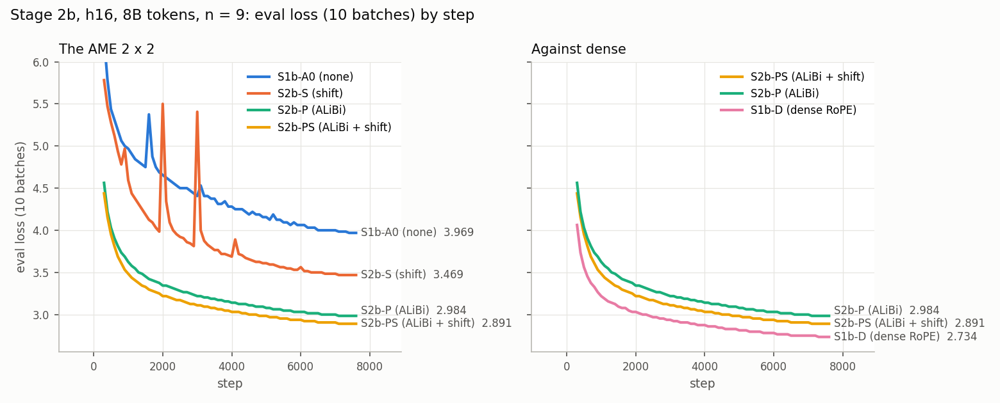

# Stage 2b — positional encoding and the shift at h16: report

**Status: wave 1 finished (2026-11-07 03:34). S2b-PS, ALiBi with the shift, is best,
provisionally: 2.8965 at n = 9, and the order of the cells matches h12. Wave 2, the
learning-rate check on S2b-PS at n = 8 and 10, is running (jobs 6260570, 6260571; done
about 18:45). n = 8 leads n = 9 at 30% of the run, so wave 3, S2b-P and S2b-S at n = 8,
started early (jobs 6261187, 6261188; decision 4). The noise-floor run S2b-N was
cancelled at Maciej's request.**

The plan is [ame_experiments.md, "Stage 2b — positional encoding and the shift at h16"](ame_experiments.md#stage-2b--positional-encoding-and-the-shift-at-h16).
This file is its record: every job, result and decision, each with its reason. Times are
CET. Stage 1b's record, which supplies the reference cell S1b-A0 and the dense baseline
S1b-D, is [stage_1b_report.md](stage_1b_report.md). Stage 2's record, the same question
at h12, is [stage_2_report.md](stage_2_report.md).

## Setup

| | |
|---|---|
| Question | Stage 2's question at h16 and 8B tokens: which AME variant is best, and how much does each component add? And do the answers match Stage 2's? |
| Design | The 2 × 2 of {no positional encoding, ALiBi} × {no shift, KV shift}. S1b-A0 (neither) comes from Stage 1b; S2b-P, S2b-S and S2b-PS are trained here; S2b-N repeats S1b-A0 with seed 124 as the noise floor |
| Positional encoding | The implemented ALiBi ladder, as in Stage 2: one fixed slope per head, horizons 16 to 8,192 tokens, here over 16 heads |
| Code and configs | Commit **`89975bbf`** on `ame_main`, for every Stage 2b run, submitted from its own clean worktree, `~/code/nano-stage2b` (branch `stage2b_lem`). Since Stage 1b's `31cbc268`, the only code change is the gqa NoPE option (`c4cb1ef6`, [stage_2_report.md](stage_2_report.md) decision 3). It does not touch AME: `src/core/ame.py`, `src/core/memory_parallel.py` and `_build_ame` are unchanged. So Stage 2b stays comparable with S1b-A0 without a re-run |
| Configs | [ame_h16_pe.yaml](../../configs/stage_2b/ame_h16_pe.yaml) (S2b-P), [ame_h16_shift.yaml](../../configs/stage_2b/ame_h16_shift.yaml) (S2b-S), [ame_h16_pe_shift.yaml](../../configs/stage_2b/ame_h16_pe_shift.yaml) (S2b-PS), [ame_h16_simplest_seed2.yaml](../../configs/stage_2b/ame_h16_simplest_seed2.yaml) (S2b-N) |
| Cluster, recipe | As in Stage 1b: LEM, 1 H100 SXM5 94 GB per run, no FSDP2, autocast bf16, micro-batch 16 × 32, 7,630 steps = 8.00B tokens, seed 123 (S2b-N: 124), 24 h limit, r16-11 excluded |

## Decisions

1. **n\* = 9, by Maciej's call (2026-11-06, about 12:00), concluding Stage 1b.** His
   words: "assume that optimal lr for h16 baseline and AME is 9 - that concludes stage 1b
   - dont run more experiemnts for stage 1b, submit now experiments from stage 2b for ame
   for lr = 9". The four files set `learning_rate: 9`, committed in `89975bbf`.

   Stage 1b's grid was then at step ~800 of 7,630 ([stage_1b_report.md](stage_1b_report.md),
   decision 3). n = 9 led dense; AME led at n = 10 and 11, where n = 9 had spiked early.
   It matches the h12 choice ([stage_1_report.md](stage_1_report.md), decision 9).

   The plan's learning-rate check still follows wave 1: the best arm at n\* ± 1 = 8 and 10.
2. **`sbatch` was run by hand**, as in Stage 2 ([stage_2_report.md](stage_2_report.md),
   decision 2). The run names read `s2b_<arm>_h16_lr9.0`, and `run_exp.py`'s tmux step
   fails on the dot. Each clone was complete, with the secrets in `exp.job`, so
   `cd <clone> && sbatch exp.job` on LEM is the step that was skipped.
3. **S2b-N cancelled by Maciej (2026-11-06, about 12:40): "we dont need that S2b-N,
   cancel that one".** Job 6255248 was cancelled while still pending and never ran; its
   clone stays on disk, unused.
   - **Consequence.** Stage 2b has no noise floor of its own: no second seed of S1b-A0
     at h16, so a tie cannot be measured at this scale.
   - **How the analysis handles it.** It takes Stage 2's h12 seed gap, S1-A0 against S2-N
     at n = 9, as a stated proxy. It reports every Stage 2b difference with that proxy
     beside it, instead of calling ties at h16.
4. **S2b-P and S2b-S re-run at n = 8 before the learning-rate check finished
   (2026-11-07 08:16).** The plan re-runs the other two arms at the new n if the check
   moves S2b-PS's best n. I started them when the check was 30% done, not at its end:
   - **n = 8 leads n = 9 at matched steps, and the lead grows.** The two runs see the
     same data in the same order (seed 123), so the comparison is paired. n = 8 overtook
     n = 9 at about step 1,500 (20% of the run) and leads by 0.006 at steps 2,000–2,199
     (table in wave 2). n = 10 trails by 0.07.
   - **h12 took the same path and ended at n = 8.** There n = 8 overtook n = 9 at about
     step 950 of 3,815 (25%); its lead grew steadily, to 0.061 in `final_ce`. At h16 the
     crossover came earlier, but the lead grows more slowly so far: 0.006 against h12's
     0.011 at 26–29% of the run.
   - **Starting now saves about 10.5 h**: wave 3 finishes around 23:45 instead of about
     10:00 on 2026-11-08.
   - **Cost if n = 9 wins after all:** about 30 GPU-h, and the two runs still show how
     S2b-P and S2b-S respond to the learning rate. The LEM grant had 72,150 of its
     100,000 GPU-h left (`service-balance`, 08:15).

   The runs use the same commit, `89975bbf`, with `trainer.learning_rate=8`; `sbatch` was
   run by hand (decision 2).

## Wave 1 — the three arms and the noise floor, at n = 9

| Arm | Positional encoding | KV shift | Job | Cemetery commit | Cemetery clone (under `.../nano/plgmstefaniak/llmrandom_cemetery/`) |
|---|---|---|---|---|---|
| S2b-P | ALiBi | off | 6255245 | `9c9e37c3` | `s2b_p_h16_lr9.0_2026-11-06_12-27-59` |
| S2b-S | none (16 zero slopes) | on | 6255246 | `10b6a080` | `s2b_s_h16_lr9.0_2026-11-06_12-28-20` |
| S2b-PS | ALiBi | on | 6255247 | `aa0aa401` | `s2b_ps_h16_lr9.0_2026-11-06_12-28-40` |
| ~~S2b-N~~ | none | off, seed 124 | 6255248 — **cancelled before it ran** (decision 3) | `d8a407e3` | `s2b_n_h16_lr9.0_seed124_2026-11-06_12-29-01` |

Every cemetery commit has `89975bbf` as its parent and adds only `exp.job` and
`generated_configs/config_0.yaml`. The plan's order (S2b-P, S2b-S, S2b-PS, then S2b-N)
was kept for submission; the runs do not depend on each other.

| Arm | n | Job | W&B run | Node |
|---|---:|---|---|---|
| S2b-P | 9 | 6255245_0 | `eedqxi1j` | r12-16 |
| S2b-S | 9 | 6255246_0 | `c2tjvh5w` | r16-12 |
| S2b-PS | 9 | 6255247_0 | `rv4xqzap` | r16-12 |

### Results — wave 1 finished 2026-11-07 02:59–03:34

Every row has n = 9 and 7,630 steps × 1,048,576 tokens = 8.00B tokens. The AME arms have
1,986.33M parameters (234.9M backbone, 1,648.36M banks; the shift arms add 1,024) and
2.121 GFLOP/token. Dense has 354.71M parameters (251.7M backbone, no banks) and 2.222
GFLOP/token. Each run wrote its final checkpoint, 23 GB for AME.

| Cell | Positional encoding | Shift | `final_ce` | Loss spikes (train) | s/step | MFU | W&B run | Commit | Config |
|---|---|---|---:|---|---:|---:|---|---|---|
| S1b-A0 (Stage 1b) | none | — | 3.9746 | steps 380 → 6.66; 1,600–1,622 → 7.00 | 6.540 | 34.4% | `n15qni7a` | `31cbc268` | stage_1b/ame_h16_simplest_lr_grid |
| S2b-S | none | ✓ | 3.4658 | steps 1,937–1,962 → 9.56; 2,971–2,995 → 8.38; 4,050–4,066 → 4.84 | 6.782 | 33.2% | `c2tjvh5w` | `89975bbf` | stage_2b/ame_h16_shift |
| S2b-P | ALiBi | — | 2.9834 | none | 6.511 | 34.5% | `eedqxi1j` | `89975bbf` | stage_2b/ame_h16_pe |
| **S2b-PS** | ALiBi | ✓ | **2.8965** | none | 6.773 | 33.2% | `rv4xqzap` | `89975bbf` | stage_2b/ame_h16_pe_shift |
| S1b-D (Stage 1b) | RoPE | — | 2.7441 | none | 5.964 | 39.5% | `eh2sjsh7` | `31cbc268` | stage_1b/dense_h16_lr_grid |

*Eval loss on 10 batches by step, from step 300, with the y-axis cut at 6. The end labels
are the last such eval, not `final_ce`. Made with
[documents/scripts/stage_results.py](../scripts/stage_results.py) `curves`.*

### Analysis at n = 9 — the plan's list

**The four cells:**

|  | no shift | KV shift |
|---|---:|---:|
| **no positional encoding** | S1b-A0: 3.9746 | S2b-S: 3.4658 |
| **ALiBi** | S2b-P: 2.9834 | **S2b-PS: 2.8965** |

**Main effects and interaction**, next to Stage 2's at the same n:

| | h16, 8B (here) | h12, 4B (Stage 2) |
|---|---:|---:|
| ALiBi without the shift (P − A0) | −0.991 | −1.134 |
| ALiBi with the shift (PS − S) | −0.569 | −0.752 |
| **ALiBi, averaged** | **−0.780** | **−0.943** |
| Shift without ALiBi (S − A0) | −0.509 | −0.493 |
| Shift with ALiBi (PS − P) | −0.087 | −0.111 |
| **Shift, averaged** | **−0.298** | **−0.302** |
| **Interaction** | **+0.422** | **+0.382** |

**No noise floor of its own.** S2b-N was cancelled (decision 3). The stated proxy is
Stage 2's h12 seed gap, 0.232, which one loss spike inflates. Against it:
- **ALiBi** is far above the floor in both rows.
- **The shift without ALiBi** (−0.51) is above it.
- **The shift on top of ALiBi** (−0.087) is below it.

S2b-PS against S2b-P is therefore a tie by the proxy rule. It has the same sign as at h12
(−0.111 at n = 9, −0.123 at n = 8), and neither ALiBi run spiked at either scale.

**Every cell against S1b-D**, dense h16 at n = 9 (2.7441):

| Cell | Gap at h16, 8B | Gap at h12, 4B (Stage 2, n = 9) | Change |
|---|---:|---:|---:|
| S1b-A0 | +1.231 | +1.407 | −0.177 |
| S2b-S | +0.722 | +0.914 | −0.192 |
| S2b-P | +0.239 | +0.274 | −0.034 |
| **S2b-PS** | **+0.152** | +0.162 | −0.010 |

The comparison matches tokens, data order and recipe. It does not match:
- total parameters: AME has 5.6×, mostly banks;
- FLOPs per token: AME is 0.95× dense;
- positional signal;
- weight decay: the AME banks are exempt, while the dense W_Q and W_K get 0.1.

**Against Stage 2, the plan's two questions:**
- **Do the four cells rank in the same order at both scales? Yes:** PS < P < S < A0 at h12
  (n = 8 and 9) and at h16 (n = 9).
- **How does each cell's gap to dense change from h12/4B to h16/8B? Every gap shrinks.**
  The weak cells shrink most: −0.18 for A0, −0.19 for S. The ALiBi cells shrink least:
  −0.03 for P, −0.01 for PS. So scale helps the position-free variants catch up. The best
  variant's distance to dense barely moves, about 0.15–0.16 nats.
- **What this measures.** Model size and tokens changed together, at almost the same
  tokens per dense parameter (21.8 and 22.6). So this is a scaling result, not the effect
  of either change alone.

**Readouts at the end of training**, averaged over the 16 layers:

| Cell | τ, mean | Shortest horizon | Attention entropy, normalized | Top-8 mass | α₂, mean \|·\| | β₂, mean \|·\| |
|---|---:|---:|---:|---:|---:|---:|
| S1b-A0 | 5.88 | ∞ | 0.930 | 0.113 | pinned 0 | pinned 0 |
| S2b-S | 8.20 | ∞ | 0.784 | 0.269 | 0.297 | 0.740 |
| S2b-P | 7.23 | 6.0 (4.1 in layers 3–4) | 0.527 | 0.574 | pinned 0 | pinned 0 |
| S2b-PS | 8.33 | 15.0 | 0.536 | 0.555 | 0.454 | 0.669 |

The h12 pattern repeats:
- **ALiBi sharpens attention** to about half the mass on 8 keys.
- **The shift is kept,** with β₂ > α₂.
- **Without the shift, τ falls and shortens ALiBi's horizons** (S2b-P: down to about 4
  tokens). With the shift, τ stays at about 8.

**The best AME variant at h16 and 8B tokens, provisionally: S2b-PS, ALiBi with the KV
shift**, at `final_ce` 2.8965, 0.152 behind dense. The plan names it only after the
learning-rate check below.

## Wave 2 — the learning-rate check on S2b-PS, at n = 8 and 10

The plan: the best arm trains at n\* ± 1. If its best n moves, the other two arms re-run at
the new n before a winner is named. The runs were submitted at 03:36 from
`~/code/nano-stage2b` at `89975bbf`, with `trainer.learning_rate=8` and `=10`; `sbatch`
was run by hand (decision 2).

| Arm | n | Job | Cemetery commit | Cemetery clone | W&B run | Node |
|---|---:|---|---|---|---|---|
| S2b-PS | 8 | 6260570 | `e51f51d4` | `s2b_ps_h16_lr8.0_2026-11-07_03-36-02` | `hjw7znbz` | r12-4 |
| S2b-PS | 10 | 6260571 | `c1df24a4` | `s2b_ps_h16_lr10.0_2026-11-07_03-36-23` | `kxt7oe48` | r12-4 |

Both started at about 03:38 and passed the startup check: 1,986,332,928 parameters and no
error. They finish around 18:45.

**At 30% (08:14, step ~2,300 of 7,630)**, train loss averaged over 200-step windows, with
wave 1's S2b-PS at n = 9 at the same steps. The runs share seed and data order, so each
row compares the same batches. `eval/loss` is logged in bf16, too coarse for gaps this
small: it reads 3.2031 for both n = 8 and n = 9 at step 2,200.

| Steps | Share of the run | n = 8 | n = 9 (wave 1) | n = 10 | n = 8 − n = 9 | h12, same share: n = 8 − n = 9 |
|---|---|---:|---:|---:|---:|---:|
| 1,000–1,199 | 13–16% | 3.5739 | 3.5566 | 3.6230 | +0.017 | +0.088 |
| 1,200–1,399 | 16–18% | 3.4941 | 3.4848 | 3.5557 | +0.009 | +0.059 |
| 1,400–1,599 | 18–21% | 3.4308 | 3.4298 | 3.4996 | +0.001 | +0.031 |
| 1,600–1,799 | 21–24% | 3.3811 | 3.3836 | 3.4546 | −0.002 | +0.011 |
| 1,800–1,999 | 24–26% | 3.3426 | 3.3453 | 3.4168 | −0.003 | +0.000 |
| 2,000–2,199 | 26–29% | 3.3074 | 3.3134 | 3.3831 | **−0.006** | −0.011 |

The h12 column is Stage 2's same check (`doi36p8k` against `ublx3ion`), in 100-step
windows at the same share of its 3,815 steps (7,630 = 2 × 3,815). Its gap kept growing:
−0.061 over the last 115 steps and in `final_ce`. At h16, n = 8 crossed earlier (20% of
the run, against 25%) but its lead grows more slowly so far. The direction is the same,
so wave 3 started now (decision 4).

Results: pending.

## Wave 3 — S2b-P and S2b-S at n = 8

Started early, while wave 2 runs (decision 4). Submitted at 08:16 from
`~/code/nano-stage2b` at `89975bbf`, with `trainer.learning_rate=8`; `sbatch` was run by
hand (decision 2). Each cemetery commit has `89975bbf` as its parent and adds only
`exp.job` and `generated_configs/config_0.yaml`.

| Arm | n | Job | Cemetery commit | Cemetery clone | W&B run | Node |
|---|---:|---|---|---|---|---|
| S2b-P | 8 | 6261187 | `def924ee` | `s2b_p_h16_lr8.0_2026-11-07_08-16-10` | `le2dr3r6` | r10-8 |
| S2b-S | 8 | 6261188 | `52b1d182` | `s2b_s_h16_lr8.0_2026-11-07_08-16-30` | `eeuebwsj` | r10-13 |

Both started at 08:17 and passed the startup check (08:27, step 50):
- **S2b-P:** 1,986,331,904 parameters, 6.52 s/step.
- **S2b-S:** 1,986,332,928 parameters (the shift's 1,024 more), 6.77 s/step.

Both match wave 1. They finish around 23:30. If wave 2 still ends with n = 9 best,
wave 1 names the winner, and these two runs are reported as a learning-rate check of
S2b-P and S2b-S.

## For Maciej

Items that need your decision. None blocks a run.

1. **n\* = 9 sits at the high-LR edge of Stage 1b's grid.** You set it while the grid was
   10% in (decision 1). The finished grid has both arms' lowest `final_ce` at n = 9,
   its edge ([stage_1b_report.md](stage_1b_report.md)), and Stage 1b stopped there by
   your call. Two hints that h16 AME wants a higher learning rate than n = 9:
   - at h12, S1-A0 kept improving down to n = 6
     ([stage_1_report.md](stage_1_report.md), decision 10);
   - here, S2b-PS at n = 8 leads n = 9 at 30% of the run (wave 2).

   S1b-A0 at n = 8, about 15 GPU-h, would give the 2 × 2's reference cell at n = 8 and
   test whether the h16 optimum moves.
2. **`run_exp.py` and run names with a dot**: see [stage_2_report.md](stage_2_report.md),
   "For Maciej" 2.
